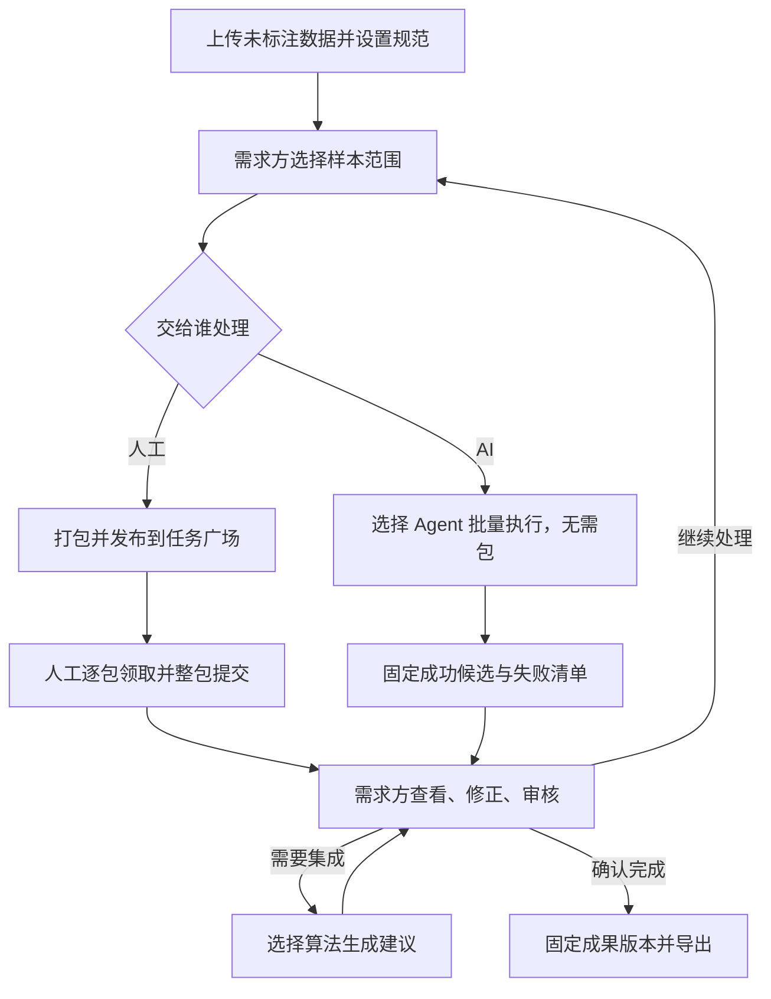

# 产品说明｜数据标注平台

更新：2026-11-09。本文描述最新产品目标，不表示功能均已实现。现有代码与待开发接口见 [接口契约](04-api.md)，团队任务见 [四人分工](05-team-and-acceptance.md)。

## 1. 产品定位与本轮范围

需求方上传未标注数据，选择交给人工或 AI 处理，查看并核查结果，必要时再次发布，最终确认并导出成果。平台提供推荐、筛选与集成建议，业务流转由需求方决定。

本轮首先跑通图片单标签分类，支持 JPG/JPEG/PNG 的 ZIP 导入。只导入原始样本，不读取外部已有标签；发现非支持文件或标签文件时报告未导入，不能显示为已采用标注。结构化、半结构化等甲方需求保留为后续范围，不在本轮宣称已经可用。

人工按包领取、完整提交；AI 按需求方选定的样本范围批量执行，不要求先打包。AI 自动标注必须真实运行，可以使用专用模型、小模型或大模型。

## 2. 参与者与权限

| 参与者 | 获得方式与职责 |
|---|---|
| 人工标注员 | 统一登录且标注平台启用后具备；查看任务摘要，自行领取包，保存草稿、完整提交 |
| 需求方 | 自主创建项目成为该项目 owner，无须管理员审批；管理数据、规范、发布、结果审核、集成与导出；也可领取任务 |
| AI 标注员 | 平台配置的独立 Agent；接收授权范围并自动产生候选结果，无人类登录账号 |
| 标注管理员 | 标注平台单独授予；管理启用状态和运行秩序，不自动获得项目原图或最终审核权 |

同一人可以在自己项目当需求方，在其他项目当标注员。统一登录只提供身份；训练 roleId 不表示标注角色。任务广场当前对部署内启用人工用户开放摘要，已有企业边界必须保留；领取前不开放工作原图和答案。

需求方选择人工或 AI，不指定某一名人工。当前不做人机同时协作编辑。同一样本先结束当前处理，再由需求方决定下一轮；不同样本可以并行处理。

## 3. 数据流与工作单位

- 样本是最小数据单位，有固定 sampleId 和原始文件引用。
- 人工任务包是领取和提交单位。默认每包 10 个样本，可配置；尾包可以不足 10 个。
- 发布轮次固定一次处理的范围、要求、规范和参考结果。人工轮次属于包，AI 轮次属于项目选定范围。
- 人工领取记录归属具体包和轮次；AI 执行记录归属选定范围和 Agent，不强行伪装成人工领取。
- 结果属于具体样本和来源，人工、AI、需求方修订及集成建议均保留版本与来源关系。

## 4. 人工流程

1. 需求方选择样本，预览打包计划、包数和每包成员，再确认发布。
2. 标注员自行领取，可领取多个包；每个包独立显示进度。
3. 部分完成可保存草稿，刷新后恢复；参考答案不自动计为本轮完成，需主动确认或修改。
4. 人工可以保存未完成草稿；正式提交时，必须完成当前领取包内的全部样本。一次人工发布计划可以拆成多个包，每包建立独立轮次，每个包独立提交：例如领取 10 个包，可以先提交其中已全部完成的 5 个包，其余包继续保存草稿；某个包内有任何样本未完成，该包就不能提交。若重新发布时只选部分样本，先按规则把所选范围拆成包，再逐包提交。
5. 提交冻结该次结果并交给需求方处理；“已交回”只表示执行者完成交付，不表示需求方审核通过，也不表示整个任务完成。

例：领取 10 个包，每包 10 张。某包完成 6/10 只能保存；完成 10/10 可以独立提交，无须等待其他 9 个包。无法继续时通过放弃/撤销结束，不以部分提交绕过单个包的完整性约束。

基础阶段每包一名人工，结构保留多人独立处理能力。未来多人使用同轮不同席位，每人都必须完整提交自己的包，不能共享唯一答案。

## 5. AI 流程与结果确认

需求方直接选择项目内全部或部分样本、规范、参考结果和合适 Agent。样本可以尚未打包，也可以来自不同已结束的人工包。AI 模型内部的推理批大小不等于人工任务包大小。

AI 逐样本持久化有效输出。批次可以部分成功；批次结束后平台固定成功结果和失败清单，需求方可以先处理成功结果，再决定失败项重试、换 Agent 或转人工。运行中展示进度，审核使用结束后固定的结果版本，失败样本不能用空标签伪装成功。AI 批次交回只表示执行结束，不表示结果已审核通过或整个任务已完成。

确认流程：

1. 先展示标注、模型版本、置信度、分数分布以及失败/未完成情况。
2. 需求方手动设置低边界 L 和高边界 H，要求 0 ≤ L < H ≤ 1。
3. 低：c < L；中：L ≤ c < H；高：c ≥ H；无有效分数单列未知。
4. 展示各档数量，允许逐项预览与排除；需求方点击批量确认后，所选答案才被接受。
5. 中、低及未知组可自行核查、修改、确认，或再次交给人工/AI。

0.60 和 0.90 仅为说明示例，不自动作为生效阈值。阈值按固定 AI 执行结果及模型版本保存，不混用不同模型分数。改阈值不自动更改过去的确认，低分也不自动成为待修正。

AI 失败项由需求方选择重试、换 Agent 或转人工；转人工时需打包后发布。AI 只是独立标注员，不具备最终验收权。

## 6. 平台推荐与再次发布

| 决策 | 平台提供 | 需求方决定 |
|---|---|---|
| 发布范围 | 建议未完成和 owner 已标记待修正的样本；活动处理中的样本禁选 | 增减、全选、确认范围 |
| 低分/未知/分歧 | 数量、筛选和预览 | 是否核查、修改或再发布 |
| 已确认结果 | 默认不选 | 是否重做；重发时明确提示当前确认将失效 |
| 执行对象 | 人工入口、能力匹配 Agent | 本轮人工还是 AI |
| 审核/集成 | 结果及依据 | 是否采用 |

再次发布可选全部或部分样本，并决定携带哪份固定结果或不展示已有答案。历史不会清空；携带答案用于修正，不展示答案用于独立标注。

例：AI 处理 1000 张，需求方确认 900 张，选择 100 张转人工，按每包 10 张形成 10 个包。每个包完成后可立即单独交需求方审核，不必等其他包全部提交。反向也成立：需求方从已提交的多个人工包选择样本，合成一次 AI 处理范围。

同一旧包只重做 4 张时，将这 4 张组成一个新的人工包，该包必须完成 4/4 后才能提交；未选的其他样本不需重标。样本跨旧包重新打包时保留来源，不覆盖旧包成员。

## 7. 需求方工作台、集成与最终成果

工作台展示当前选定候选、各来源历史、完成情况、审核状态和失败原因。只有需求方明确操作才能产生待修正或已确认状态。支持单条修订和批量确认，修订创建新版本，不覆盖原答案。

集成模块接收一批样本和选定的多份独立答案，首个算法为图片分类严格多数投票。无过半标签返回未形成共识，有效独立答案不足两份返回输入不足。同一人重复保存不能多计票；基于某答案修订的多份结果不自动当独立选票。

投票支持比例与模型置信度分别展示。集成建议要经需求方采用，不替代审核。

最终成果是需求方确认的一份固定样本范围及对应答案。范围内须全部有有效已确认结果，且没有活动处理；缺项提示不能静默排除。形成成果不必先创建人工包。部分范围完成不代表整个项目完成，界面显示范围和覆盖数量。

完成后进入成果列表，不删除任务和历史。图片分类导出采用 CSV＋manifest 的 ZIP，保留原始文件映射、标签、结果和审核来源；原图是否打包作为明确选项。首次交付不把未审核候选或草稿混入成果。

## 8. 编辑器边界与交付口径

只裁剪复用 Label Studio 适合的编辑器代码，不部署启动完整 Label Studio 服务。原图读取、草稿、提交、审核与导出由本平台后端负责；AI 也写入同一套样本结果体系。

近期先完成图片分类真实闭环，复杂推荐、人机助手、外部标注导入及其他模板后续推进。界面、算法、真实模型和实际部署分别验收，不把有设计或有接口当作已交付。
