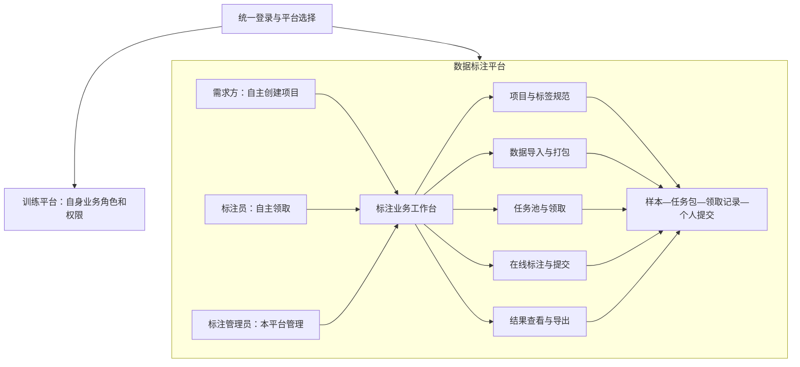
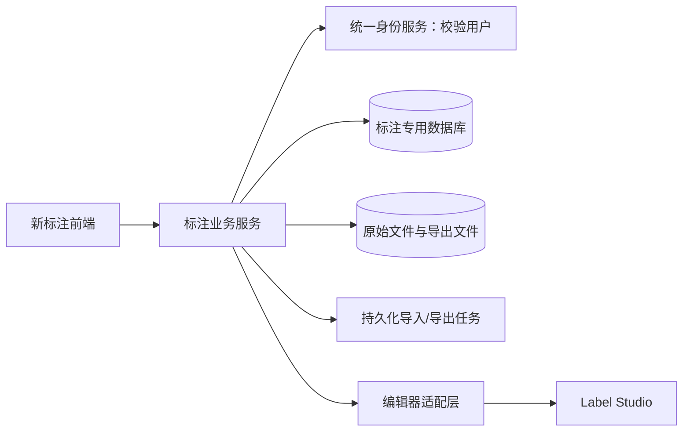

# 总体架构设计

## 1. 产品架构与角色作用域

三个角色全部在标注平台边界内。统一登录提供身份，不统一授予训练与标注业务权限。训练平台的全局roleId不得直接用来表示标注需求方、标注员或标注管理员。

## 2. 推荐运行架构（内部）

统一前端新增 `/labeling` 页面；新业务API使用 `/api/labeling/v1`。新标注后端是一个模块化服务，复用团队现有Java/Spring Boot能力；使用专用PostgreSQL库和独立文件目录或bucket。数据库、存储方式是设计建议，尚未部署。

现有手动演示服务仅作为内部兼容边界保留，不纳入甲方架构展示。不得复用其owner＋单份marks数据库来实现多人提交。现有训练与演示的接口、数据卷和存储不迁移到新服务。

## 3. 身份、角色与准入

- 用户ID来自统一身份服务，标注平台只保存identityUserId映射，不复制密码。
- 每个人对应HUMAN actor；平台访问状态与LABELING_ADMIN授予记录只控制标注平台，不变更训练角色。
- 普通启用用户执行创建项目接口，即成为该项目owner；不建立“需求方待审批”状态。
- 创建准入集中在ProjectCreationPolicy（逻辑边界，不要求新增复杂框架）；V1规则是已登录且标注平台启用即可创建。
- 未来审批制只替换该准入规则，另加申请记录；已有项目管理权不因创建策略变更自动丢失。
- 任务、样本、文件、编辑器及导出下载都由后端逐请求授权，不能凭知道ID或隐藏按钮判断权限。

## 4. 模块边界

| 模块 | 负责 | 不负责 |
|---|---|---|
| 项目与规范 | owner、标签版本、项目状态 | 改写训练用户角色 |
| 数据与打包 | 分片上传、解析、稳定样本ID、确定性打包 | 创建共享的唯一标注答案 |
| 任务分配 | 开放池、候选筛选、原子领取席位、回收 | 绕过权限直接分配文件 |
| 编辑器适配 | assignment＋sample映射、配置、读取编辑结果 | 判定项目完成、代替业务提交 |
| 提交 | 校验全包、冻结个人结果、幂等 | 自动融合多人答案 |
| 导出 | 固定提交清单、转换、映射文件、下载授权 | 静默混入草稿或丢弃第二人结果 |

## 5. 状态与一致性

项目：DRAFT → OPEN ↔ PAUSED → ARCHIVED（归档前需处理有效领取）。项目暂停阻止新领取、数据访问和草稿/提交写入；项目owner仍可查看已有结果并导出。暂停恢复后原有效领取可继续。

包状态表示OPEN/PAUSED/CLOSED，完成数量由提交席位计算，不把一人提交当成整个包完成。

领取：CLAIMED → IN_PROGRESS → SUBMITTED；CLAIMED/IN_PROGRESS可进入RELEASED或REVOKED。提交为终态；首期无返工接口。草稿不自动算提交，回收后旧页面写入失败。

外部编辑器操作不可能与业务数据库形成同一事务：先写pending映射，再幂等创建外部任务；失败进入可重试状态。同步时检查作者、assignment、sample、规范版本与摘要；提交前冻结已同步的草稿revision清单。外部保存但未同步成功时，界面不得显示“平台提交成功”。

## 6. 编辑器接入与扩展

已确定使用Label Studio。2026-11-02调研记录指出社区版所有用户可见所有项目，不能直接满足逐领取隔离。固定发行版、版本与集成模式后，用两账号实测直接URL、任务API、文件读取、导出及独立结果；未通过不能上线。具体官方能力以部署版本实测为准，参见[调研来源与代码核对依据](06-research-evidence.md)，不在本轮重作选型。

优先完成一个明确任务模板的导入、编辑、同步和导出。服务凭据只在后端，不能发送共享管理员Token给浏览器。模型预标注和Webhook不是首期主链路。

扩展接口：

- 分配策略输入任务信息＋标注员信息，输出候选assignment建议、理由和策略版本；实际授予必须经过统一领取事务。准确度无依据时为空，不用完成率冒充。
- 结果集成输入同一样本的固定个人提交ID列表，输出独立融合版本和来源，永不覆盖原提交；V1不建假融合记录。
- 模型actor预留kind=MODEL，未来内部调度生成结果；首期不创建模型运行接口。用户自接模型入口后置。

## 7. 发布与保存

原始文件只读；规范、发布批次和提交不可变。导入/导出任务持久化、可查询与幂等重试。容量阈值由真实样例和环境确定，不承诺无限上传。新服务失败不应破坏旧平台数据；上线前独立备份/恢复演练，统一前端发布需回归登录与训练入口。
