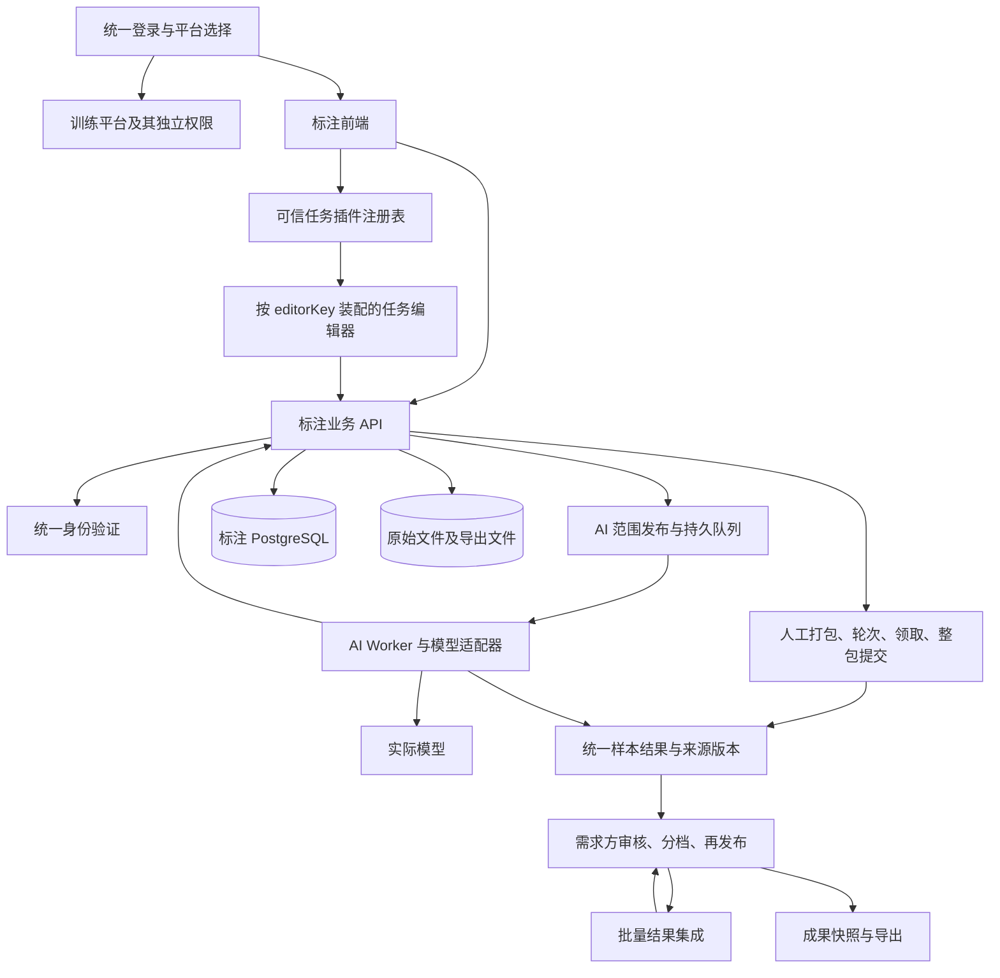

# 总体架构｜人工按包、AI 按范围

更新：2026-11-11。本文描述面向多种数据类型的通用标注平台架构。图片分类和工业能耗分别是图像、时序插件示例，能耗验收要求见[任务插件、标注格式与工业能耗验收设计](14-task-plugins-and-energy-acceptance.md)。目标架构尚未全部实现；与[产品说明](01-product.md)、[数据库设计](03-database.md)、[接口契约](04-api.md)配套。现有服务式 Label Studio 接入须改造，不能按旧部署方式直接验收。

## 1. 平台和运行边界

统一前端保留登录与平台选择，新业务位于 /labeling，API 前缀 /api/labeling/v1。标注服务继续使用 Java/Spring Boot、专用 PostgreSQL 和独立文件目录或 bucket；不复制密码，不迁移训练与旧演示的数据。



无完整 Label Studio 服务、数据库、项目/任务 API 或共享管理员 Token。裁剪编辑器随统一前端构建；模型工作线程可为同一服务后台任务或独立进程，使用相同队列契约，不另造第二个业务系统。

旧演示仅作为内部运行兼容事项，不进入甲方架构，不用其 owner＋单份 marks 实现新业务。发布统一前端需回归登录和训练入口。

## 2. 两种执行方式，共同结果体系

| 项目 | 人工 | AI |
|---|---|---|
| 发布范围 | 固定包的全部成员；部分返工先创建新包 | 项目内明确样本集合，可跨已结束的包、可从未打包 |
| 接收方式 | 发布到广场，自主领取 | owner 选择 Agent 后进入持久队列 |
| 执行身份 | HUMAN actor、assignment | MODEL actor、ai_execution |
| 保存 | 草稿逐样本保存 | 输出和失败按样本持久化 |
| 交付 | 可保存不完整草稿；当前领取包内全部样本有效完成后才生成 submission；同一发布计划的多个包逐包独立提交 | 批次终结时固定成功结果与失败清单，可部分成功；需求方可先处理成功结果 |
| 审核 | owner 审核具体结果版本 | owner 先看结果，再设阈值和明确审核 |

共同结果关联 projectId/sampleId/specVersionId 和唯一来源，不要求每个结果都存在 packageId/assignmentId。AI 不调用人工全范围提交接口。人工交回或 AI 批次结束都只表示执行结果已交付，不等于需求方审核通过，也不等于整个任务完成。

同一样本不同时开放给人工和 AI。持久 sample_work_claim 将样本占用到一个活动 round；同一人工轮次未来可有多人席位，共用该轮占用，不冲突。不同范围可并行，不做全项目串行锁。

## 3. 模块责任

| 模块 | 负责 | 负责人 |
|---|---|---|
| 身份与项目 | 统一身份映射、标注授权、自主建项、规范版本 | A |
| 数据与打包 | 上传解析、稳定样本、文件授权、人工包计划 | B，A负责发布事务 |
| 发布与分配 | 范围快照、参考版本、占用、人工领取、AI execution 创建 | A |
| 结果服务 | 草稿、人工完整提交、AI 候选、owner 修订、不可变 result_revision | A，D调用 |
| AI 执行 | Agent 能力、模型调用、重试、进度与批次收尾 | D，A约束生命周期 |
| 编辑器适配 | 控件裁剪、分类转换、事件与宿主对接 | D，C集成 |
| 查询与选择 | 分页、分档计数、固定 selection 快照 | B |
| 审核 | 阈值保存、逐条/批量确认、待修正和成果完成 | A |
| 集成与导出 | 批量算法输入输出、成果转换、授权下载 | B |
| 用户工作台 | 发布、任务、AI 进度、分档预览、审核、再发布、成果 | C |

需求方创建项目时即获得该项目 owner 权限。LABELING_ADMIN 只作用于标注平台，不默认赋予所有项目原始数据访问权。角色和资源校验均在后端逐请求执行。

## 4. 面向对象与扩展

```text
AnnotationAgent
├── HumanAgent
└── AiAgent
    ├── VisionAgent（首期实际实现）
    └── TextAgent（扩展设计，不宣称已经可用）
```

基类提供身份、能力、工作状态和队列访问的业务抽象。HumanAgent 经人工领取和页面交互推进，AiAgent 经队列 Worker 调用模型推进；不强制二者使用相同 HTTP 接口或一个阻塞 execute 方法。

队列和结果以数据库为事实来源，不把每个用户的工作只放在 Java 内存列表。首期可由现有服务后台 Worker 轮询，无须为预留扩展新增复杂消息平台。

模型适配器输入固定样本、规范、可选参考结果和运行配置，输出该模板的结果结构、真实 confidence（可空）和模型/规则版本；labelId只是图片单标签模板的输出。模型能力必须匹配实际标签，不能用检测框替代分类答案。参考输入不保证每个模型都能利用；不支持时在创建前拒绝或让 owner 明确选择无参考模式，不能静默忽略。

集成接口接收整批固定样本和多份结果，返回逐样本建议与输入来源。多数投票只是首个实现，不能把接口限制为一次一张图；评分与投票比例不能混作模型 confidence。

## 5. 状态、审核与版本

项目沿用 DRAFT/OPEN/PAUSED/ARCHIVED。第一次人工发布或 AI 发布均可使 DRAFT 成为 OPEN。暂停停止新领取/执行及结果写入，owner 可看历史结果；恢复仅让仍有效工作继续，取消和已提交记录不复活。

人工 assignment 为 CLAIMED→IN_PROGRESS→SUBMITTED，或活动态转 RELEASED/REVOKED；每个 assignment 对应一个领取包，提交完整性只校验该 assignment 当前包内冻结的全部成员。同一发布计划的其他包不阻塞它提交；例如 10 个包可先独立提交其中已完成的 5 个。包内只完成部分时仍是草稿，不允许对单个包部分提交。重新发布的人工样本范围先拆成包，再按包独立领取和提交。AI execution 终态可为 PARTIAL，成功结果和失败清单都必须固定，需求方可先处理成功结果，之后再决定失败项如何处理。

AI 为 QUEUED→RUNNING→SUCCEEDED/PARTIAL/FAILED/CANCELLED。执行状态和结果审核分开。终结事务固定结果清单、计数和错误，之后迟到回调无权写入。owner 重试失败样本创建新执行与来源关联；技术重试可在未结束执行内发生，但必须用 generation/attempt 防重。

审核以 sample_review 的当前选择结果和 revision 为依据：没有结果可为 UNREVIEWED，有候选可为 PENDING，owner 标记 NEEDS_REVISION 或明确 ACCEPTED。新候选不会自动覆盖已选答案；重新发布已确认样本时，事务内重置当前审核并保留历史。

AI confidence policy 按固定执行快照和模型版本保存。设置阈值仅分档，审核时固定明确选择结果 ID 和 reviewRevision；不是在点击后再查询一次“所有高分”并悄悄扩大范围。

## 6. 一致性与故障恢复

数据库短事务负责权限、范围占用、状态转换和幂等记录；模型推理、文件传输、导出压缩都在事务外。外部执行返回时重新验证 actor、项目、执行状态和 fencing generation，再接受输出。

- 人工发布计划支持选择子集和重复轮次；旧“同导入批次只能发布一次”不能继续限制新计划。
- 发布前固定 selectionHash；发布事务重验来源版本、审核 revision、规范和样本占用，失败整体回滚，不部分重置确认状态。
- 部分重新发布不改旧包成员；整包可在原包开新轮次；选取原包子集或跨包范围时重新打包成新包。
- 保存与提交互斥：提交锁领取并按稳定 sampleId 锁全部草稿，校验全范围；不同人工包互不等待。
- AI Worker 原子领取执行租约，网络超时可造成重复计算，但幂等和 fencing 防止重复采纳；不宣称外部调用绝对只执行一次。
- owner 批量审核以固定 selection 消费，任何过期项整体返回冲突；较大输入应限制数量或异步处理，不无限持锁。
- 导出读取不可变 final_snapshot_item，不临时查最新候选；无人工包也可形成成果。

具体 FK、索引、锁顺序与回填见 03。文件持久化后才提交数据库引用；成功产物发布前校验完整性，失败不得显示成功。

## 7. 现有能力如何演进

保留现有身份、导入、人工草稿和完整提交骨架。新增项目级 round/AI execution、统一结果来源、审核、选择快照、集成和成果；人工 assignment 增加 round 归属，不清空历史。

旧备份中曾试验 V6 editor_mapping/editor_session 和服务式 LS 接入；这些实现未合入当前 backend 分支。新路径不依赖外部项目/任务，构建和部署也不要求启动完整 LS 服务。若某个环境曾应用过旧 V6，后续迁移前先核对该环境的 Flyway 历史。具体组件契约见 [编辑器接入](10-editor-integration.md)。

模型与集成是真实首期任务，不能仅建假表或假输出验收。数据库新迁移编号由 A 核对所有分支及环境迁移历史后分配，不修改已经执行的迁移。本文不执行迁移或部署。

## 8. 任务插件与公共核心

公共核心只处理与具体数据领域无关的身份授权、项目、发布轮次、人工领取席位、AI执行、来源版本、审核、质检记录和成果；不在公共核心定义能耗列、图像坐标或文本片段等领域字段。任务插件通过稳定的注册键提供数据导入/解释、editorKey、输入和结果schema、服务端语义校验、完成规则、支持的Agent/集成能力及导出器。前后端根据项目冻结的模板ID和版本装配对应实现，公共流程不需要为每个模板复制一套。

第一版使用随构建发布的可信注册表，不支持用户上传可执行插件。新增能耗模板时复用同一状态机，不另建时序标注业务库。接入任务可能只需配置已有输入和结果原语，也可能需要新导入器、控件或领域校验；不得承诺所有新任务只增加前端页面即可完成。

输入最小单位由导入器决定：图片是一张图，能耗是一站点一日24点。一个CSV可以包含很多样本，后端按授权切片返回；独立AI Worker只经内部执行接口读写，不直接持有业务数据库权限。

结果分公共来源层和插件类型化payload，JSON结构校验不能替代领域语义校验。模板及schema摘要随规范冻结；已确认成果由模板对应的导出器生成。当前图片分类旧格式继续兼容，`annotation-record-v1`是平台内部的版本化扩展格式草案，需通过图像和时序结果互操作验证，现阶段不能称为行业标准。质检、金标准和统计属于通用业务；每种统计/集成算法的适用字段由插件声明，平台不能把图片分类多数投票直接套到任意数据。
