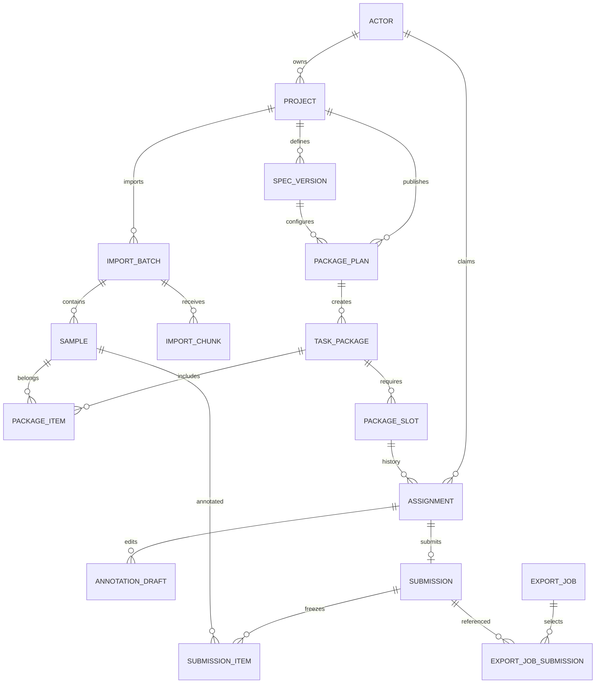

# 数据库设计草案

目标：PostgreSQL专用库。业务ID在数据库中为UUID；API以规范UUID字符串传递（如 `550e8400-e29b-41d4-a716-446655440000`），调用方将其视为不透明ID，不自行解析或生成。统一身份服务的用户ID保留text并原样映射。时间timestamptz/UTC，文件大小bigint，结构化结果jsonb。引用关系默认禁止级联删除业务记录。

实现状态（2026-11-04）：标注服务已有 `V1__create_actor.sql` 和 `V2__create_projects_and_spec_versions.sql` Flyway迁移；V1已应用后不得修改原迁移，后续结构变更新增版本。V2的幂等表先以业务资源ID实现同步项目/规范创建的重放；异步任务和通用响应快照仍需后续扩充。其余本文件的任务、上传、提交、导出表仍是设计稿。

## 1. 实体关系



N=2不复制样本文件，而为每包创建2个slot。每个slot可有历史领取，但同一时刻仅一份有效或已提交领取。每次重新领取使用新assignmentId。

## 2. 表与字段

内部实体ID及其外键为uuid；identity_user_id、外部编辑器ID、幂等键、角色码保留text等原类型，不强制转换为uuid。status/kind按枚举或CHECK校验，created_at/updated_at为timestamptz；字段标为可空才允许NULL。用户名仅作展示，identity_user_id才是身份关联键。以下名称与组合外键使用完整字段名。

| 表 | 主要字段 | 关键约束/索引 |
|---|---|---|
| actor | id、kind(HUMAN/MODEL)、identity_user_id(text，可空)、display_name、status(ENABLED/DISABLED) | HUMAN必须有identity_user_id且唯一；MODEL必须为空。V1仅人工actor |
| actor_role_grant | actor_id、role_code、granted_by、created_at | 主键(actor_id,role_code)；仅LABELING_ADMIN；不是训练角色 |
| project | id、owner_actor_id、name、description、task_type、status、visibility、revision | owner外键actor；索引(owner_actor_id,created_at,id)；V1 visibility=PLATFORM仅公开任务摘要，不直接授予数据/管理权限 |
| spec_version | id、project_id、version_no、task_type、labels(jsonb)、instructions、editor_config、schema_version、frozen_at(可空) | 唯一(project_id,version_no)；首次成功发布时冻结；新规则创建新版本 |
| import_batch | id、project_id、status、original_name、storage_key、size_bytes、received_bytes、sha256、error_code(可空) | 索引(project_id,status)；长度非负且received_bytes不超过size_bytes；READY前完成文件校验 |
| sample | id、project_id、batch_id、source_path、storage_key、content_sha256、media_type、metadata(jsonb) | 唯一(batch_id,source_path)；batch必须属于同project；同内容不自动合并不同样本 |
| package_plan | id、project_id、batch_id、spec_version_id、package_size、annotators_per_sample、status、selection_hash、published_at(可空) | batch/spec必须同项目；size/N均>0；同批次仅一条published_at非空的计划；发布后不清空时间 |
| task_package | id、plan_id、sequence_no、status、sample_count、required_count、revision | 唯一(plan_id,sequence_no)；sample_count/required_count>0；人数必须等于计划N，发布后冻结 |
| package_item | package_id、plan_id、batch_id、sample_id、ordinal | 主键(package_id,sample_id)；唯一(plan_id,sample_id)、(package_id,ordinal)；ordinal>0；组合外键保证包属计划、样本属计划批次 |
| package_slot | id、package_id、slot_no | 唯一(package_id,slot_no)；slot_no>0；发布校验必须完整覆盖1..N；发布后不增删 |
| assignment | id、slot_id、package_id、actor_id、status、revision、claimed_at、ended_at(可空)、release_reason(可空) | slot必须属于package；见下方两项部分唯一约束 |
| annotation_draft | assignment_id、package_id、sample_id、result_format、result(jsonb)、explicit_done、revision、saved_at | 主键(assignment_id,sample_id)；组合外键保证样本属于领取的包；revision>=1 |
| submission | id、project_id、package_id、assignment_id、spec_version_id、submitted_by、submitted_at、content_hash | 唯一assignment_id；组合外键绑定领取、作者、规范和项目；冻结后禁止更新/删除 |
| submission_item | submission_id、package_id、sample_id、draft_revision、result_format、result(jsonb)、explicit_done | 主键(submission_id,sample_id)；组合外键保证包成员归属；draft_revision>=1、explicit_done=true；提交后不可变 |
| editor_mapping | assignment_id、package_id、sample_id、provider、external_project_id(可空)、external_task_id(可空)、sync_status、external_annotation_id(可空)、result_hash(可空)、synced_revision(可空)、error_code(可空) | 主键(assignment_id,sample_id,provider)；包成员组合外键；READY须有外部project/task ID；唯一(provider,external_project_id,external_task_id)，未映射时允许NULL |
| export_job | id、project_id、requested_by、status、format、selection(jsonb)、progress_snapshot(jsonb)、storage_key(可空)、checksum(可空)、error_code(可空) | selection只存筛选参数；progress_snapshot冻结同次快照的完成情况；提交清单由关联表保存；索引(project_id,created_at) |
| export_job_submission | export_job_id、project_id、submission_id、content_hash | 主键(export_job_id,submission_id)；组合外键保证导出任务和提交属于同项目；摘要等于冻结提交摘要；索引(submission_id) |
| import_chunk | batch_id、offset_bytes、size_bytes、sha256、storage_key | 主键(batch_id,offset_bytes)；batch外键；offset>=0、size>0；批次行锁下校验顺序及总长度，文件持久化后才记回执 |
| idempotency_record | actor_id、operation、idempotency_key、request_hash、resource_id、created_at | 主键(actor_id,operation,idempotency_key)；V2同步建项/建规范时指向已创建资源；异步操作的通用请求状态模型仍未实现 |
| audit_event | id、actor_id、project_id(可空)、action、resource_type、resource_id、reason(可空)、created_at | 追加记录；索引(project_id,created_at)；不得记录Token/密钥或完整原始数据 |

数据类型细节：name/title建议varchar(200)，外部ID/路径使用text，revision/draft_revision/synced_revision用bigint且为正，version_no/包内计数用integer，字节数及分片offset用bigint。API整数不得超过JavaScript安全整数范围；容量及revision越界应明确拒绝。结果JSON不存原始图片字节，storage_key不作为公开文件地址。SHA-256按64位十六进制字符串校验；JSON摘要采用明确版本的规范化序列化规则。

## 3. 必须落地的约束

### 3.1 席位与发布唯一性

assignment的slot_id、package_id、actor_id、status均NOT NULL，状态受CHECK约束。保留两项部分唯一索引：

```sql
CREATE UNIQUE INDEX uq_assignment_slot_reserved
ON assignment(slot_id)
WHERE status IN ('CLAIMED', 'IN_PROGRESS', 'SUBMITTED');

CREATE UNIQUE INDEX uq_assignment_actor_package_reserved
ON assignment(package_id, actor_id)
WHERE status IN ('CLAIMED', 'IN_PROGRESS', 'SUBMITTED');

CREATE UNIQUE INDEX uq_plan_batch_published
ON package_plan(batch_id)
WHERE published_at IS NOT NULL;
```

提交后席位永久保留；RELEASED/REVOKED不占席位，重新领取生成新assignment，不继承旧草稿。发布事务原子写入status=PUBLISHED和published_at；CHECK要求两者同时成立或同时不成立。发布后的计划不退回草稿、不清空published_at，归档通过project控制；否则部分唯一索引会被绕过。同批次可有失败/未发布计划，但只允许一个成功发布。重试同一计划返回原发布结果；另一计划抢先发布则返回BATCH_ALREADY_PUBLISHED。

### 3.2 完整归属链

以下箭头表示组合外键，引用端各字段均NOT NULL。被引用组合建立相应普通UNIQUE键；默认禁止级联删除。不能只验证传入ID存在。

| 引用字段 | 被引用字段 | 保证 |
|---|---|---|
| sample(batch_id,project_id) | import_batch(id,project_id) | 样本批次与项目一致 |
| package_plan(batch_id,project_id) | import_batch(id,project_id) | 计划批次属于项目 |
| package_plan(spec_version_id,project_id) | spec_version(id,project_id) | 计划规范属于项目 |
| package_item(package_id,plan_id) | task_package(id,plan_id) | 包属于计划 |
| package_item(plan_id,batch_id) | package_plan(id,batch_id) | 使用计划指定批次 |
| package_item(batch_id,sample_id) | sample(batch_id,id) | 样本来自该批次 |
| assignment(slot_id,package_id) | package_slot(id,package_id) | 席位属于包 |
| annotation_draft(assignment_id,package_id) | assignment(id,package_id) | 草稿属于领取的包 |
| annotation_draft(package_id,sample_id) | package_item(package_id,sample_id) | 草稿样本是包成员 |
| submission(assignment_id,package_id,submitted_by) | assignment(id,package_id,actor_id) | 提交包及作者与领取一致 |
| submission(spec_version_id,project_id) | spec_version(id,project_id) | 提交规范属于项目 |
| submission_item(submission_id,package_id) | submission(id,package_id) | 提交项属于提交的包 |
| submission_item(package_id,sample_id) | package_item(package_id,sample_id) | 提交样本是包成员 |
| editor_mapping(assignment_id,package_id) | assignment(id,package_id) | 编辑器映射属于领取 |
| editor_mapping(package_id,sample_id) | package_item(package_id,sample_id) | 编辑器只映射包成员 |
| export_job_submission(export_job_id,project_id) | export_job(id,project_id) | 导出关联属于任务项目 |
| export_job_submission(submission_id,project_id) | submission(id,project_id) | 不引用其他项目提交 |

submission仍需在提交事务中沿package→plan验证project_id及spec_version_id等于发布计划绑定值；外键只证明规范属于项目，不能证明它是该包的规范。导出关联content_hash从不可变submission读取，禁止客户端填写。对submission插入增加数据库校验触发器核对包计划的项目/规范，防止绕过服务层写错。对草稿和映射，包与发布规范的关系通过不可变包计划取得。

### 3.3 发布和提交的集合完整性

- 发布前检查：有效样本至少1条；READY批次的有效样本集合等于全部package_item样本集合；无遗漏、重复、外批次样本；按冻结排序确定包边界，末包可以不足package_size。
- 每包sample_count等于成员行数，required_count等于计划annotators_per_sample；实际slot_no集合必须恰为1..N。每包成员ordinal恰为1..sample_count。
- 提交前检查：客户端sample/revision清单、服务器已完成草稿和包成员集合完全对应，不接受重复sampleId；每个revision一致且explicit_done=true，结果通过绑定规范验证。
- 外键保障归属，服务事务保障集合完整；所有业务写入经过服务。发布成员/席位、冻结规范、正式提交及提交项由数据库触发器禁止后续更新/删除（提交项只能在该领取尚未SUBMITTED的同一提交事务中插入）。数据库迁移账号与业务账号分离，业务账号不得修改保护触发器。

### 3.4 规范冻结与索引

编辑规范与发布都必须先锁同一spec_version行。首次正式发布设置frozen_at；触发器阻止冻结版本内容修改、删除或清空冻结时间。规范task_type必须等于项目task_type；项目存在规范/数据后不允许原位切换任务类型。READY批次的样本内容不再覆盖，已发布计划/包/成员/席位不再变更；状态管理字段按允许转换更新。

除表内主键/唯一索引外，至少补齐外键引用侧及常用列表索引：sample(batch_id,project_id)、package_plan(batch_id,project_id)、package_plan(spec_version_id,project_id)、package_item(plan_id,batch_id)、package_item(batch_id,sample_id)、assignment(slot_id,package_id)、assignment(actor_id,status,claimed_at)、annotation_draft(package_id,sample_id)、editor_mapping(package_id,sample_id)、submission(project_id,submitted_at)、submission(package_id)、submission_item(package_id,sample_id)、export_job_submission(submission_id,project_id)。其他外键按查询/约束检查补齐；已有索引最左前缀覆盖时不重复创建，正式DDL通过执行计划再调整。

## 4. 关键事务与并发

### 4.1 锁定规则

V1使用READ COMMITTED，导出清单快照使用REPEATABLE READ短事务。通常锁的是行，不是整张表；所有多行操作按稳定ID顺序。

全局顺序：幂等记录 → actor（涉及多人按ID排序）→ project → spec_version → import_batch → package_plan → task_package → package_slot → assignment → annotation_draft → editor_mapping → submission/提交项 → export_job/导出关联 → 审计追加。只取实际需要的锁；新插入行由插入事务持有，不为了遵守顺序读取锁定全部表。关联ID可预读用于定位，但拿锁后必须重读校验。不得先锁assignment再反向申请slot或project锁。

| 操作 | 行锁与并发规则 |
|---|---|
| 身份启用检查 | 调用者actor用FOR SHARE；禁用用FOR UPDATE。管理操作涉及其他actor时统一排序，拿锁后复核权限 |
| 领取、保存、提交 | project与task_package用FOR SHARE并复核状态；不同包/席位可并行 |
| 暂停/恢复/归档 | project用FOR UPDATE；等待此前持共享锁的短事务结束，再修改状态；提交后的新请求被拒绝 |
| 领取 | slot用FOR UPDATE；选择空席可用SKIP LOCKED，拿锁后重查有效/已提交assignment；唯一索引兜底 |
| 保存草稿 | 已IN_PROGRESS的assignment用FOR SHARE，草稿用revision条件更新；首次CLAIMED转IN_PROGRESS直接申请FOR UPDATE后复核，不先共享再升级锁 |
| 提交、放弃、回收 | slot和assignment均FOR UPDATE；提交再按sampleId顺序锁已有草稿，阻止保存与终态转换并发 |
| 发布/规范编辑 | project发布时FOR UPDATE，spec_version、batch、plan依序FOR UPDATE；冻结与规范编辑互斥 |

首次草稿创建用主键冲突保护，baseRevision=0仅允许不存在时插入；已有草稿执行WHERE revision=baseRevision的原子更新，影响0行返回REVISION_CONFLICT。保存时assignment共享锁一直持有至提交，让提交/回收的排他锁等待保存完成；不同样本的保存可以并行。

SKIP LOCKED暂时选不到席位不能直接断言永久领满：若仍有未占席位但正被锁定，返回CLAIM_BUSY；已无剩余席位才返回SLOT_FULL。若锁争用后提交使最后空位消失，也允许返回CLAIM_BUSY让客户端刷新。本人重复占席由唯一约束转ALREADY_CLAIMED。

### 4.2 业务事务

- 发布：先短事务把DRAFT或FAILED计划转BUILDING；后台构建不可见包/成员/slot；进入BUILDING后计划参数及selection_hash固定，修改需求须新建未发布计划。相同plan仅一个构建者，使用数据库事务锁控制；分批构建只在BUILDING状态且持计划锁写入。最终发布按上述顺序持锁，复核批次/规范/selection_hash及完整集合，冻结规范、写published_at、置PUBLISHED，并将首次发布的DRAFT项目置OPEN，整体原子可见。READY样本不可变保证构建稳定。PAUSED/ARCHIVED禁止发布；重试同一计划使用(plan,sequence_no)、(plan,sample)、(package,slot_no)等唯一键，不重复生成。失败保持不可领取，已提交成功的计划不改FAILED。
- 领取：按顺序取得actor/project/package锁，确认计划PUBLISHED、项目和包OPEN、本人有权限，再锁席位并复核，原子新建assignment与审计。不在锁内调用Label Studio或文件存储。
- 保存/同步：外部结果先在事务外读取；进入短事务重新检查身份、项目、包、assignment有效性，校验映射、作者、规范、样本和baseRevision，再写草稿及同步记录。并发变更返回409，不自动覆盖新草稿。不要把浏览器传来的任意结果当作已验证编辑器结果。
- 提交：锁assignment及全部包内已存草稿，校验完整样本/revision集合和规范，生成不可变submission/items、摘要，并将assignment置SUBMITTED、设置ended_at、推进revision、记录审计，一次提交。同幂等键重试返回原submissionId；不同键且已提交返回ASSIGNMENT_CLOSED。
- 放弃/回收：本人放弃→RELEASED；管理员或受控回收任务→REVOKED，reason必填。锁定后拒绝SUBMITTED，设置ended_at并推进revision。旧草稿保留，新领取使用新ID。暂停时可执行回收以满足归档条件，不准以回收修改已提交结果。
- 暂停：以暂停事务提交为边界，之前已拿共享锁的操作允许先完成；之后的新领取、工作数据访问、草稿保存/同步及提交拒绝。已经发出的网络字节无法撤回；编辑器旧页面的迟到保存必须在平台重新鉴权并拒绝，恢复后仍有效领取可继续。owner仍可读历史结果并导出。
- 导出：在同一REPEATABLE READ短事务中检查owner权限，选定并验证同项目提交，写export_job_submission及对应摘要，同时冻结progress_snapshot；后台只读取该清单。空清单返回NO_SUBMISSIONS。后台开始、产物发布和每次下载都重查权限；暂停允许owner导出，归档允许历史结果导出但不允许新增标注或导入任务。不会随执行时间增加后来提交。

### 4.3 幂等、失败与外部操作

幂等键包含调用者、方法、具体资源路径和key。同步写操作的幂等记录、业务写入与结果响应在同一事务提交，失败一起回滚；相同键的并发请求等待/冲突后重读结果，不能重复执行。异步发布、导入、导出在短事务写持久任务并返回其ID，后续查询任务状态；相同键返回同一任务，不重复创建任务。记录至少保留至资源归档清理，实际清理期限上线前确定；业务唯一约束长期保留。

40P01（死锁）和40001（序列化失败）最多重试整个数据库事务3次并随机退避；重试耗尽返回503 TRANSACTION_RETRY_EXHAUSTED。23505按已知约束名区分重复领取、批次重复发布、幂等冲突，转换对应409或读取幂等原响应；未知约束错误记服务错误，不能一概当领取冲突。55P03按场景返回409 RESOURCE_BUSY。不无条件重试所有数据库错误，也不在数据库重试闭包中发送外部请求。

文件、对象存储和编辑器无法参加业务库事务：

- 上传时持久化分片文件并核对摘要，再在短事务中插入import_chunk回执并推进received_bytes；同offset同摘要重试返回原回执。崩溃产生孤立文件时按批次和摘要重认领，不能仅凭文件存在推进offset。
- 原始文件/解析结果使用稳定key、写后校验且不覆盖已发布内容；最终确认文件完整后才置READY。解析失败不允许发布，重试复用稳定sample ID。
- 导出文件先写临时key，校验完成后才提交storage_key/checksum与SUCCEEDED；下载只读成功记录。孤立临时文件在确认无活跃任务引用且超过保留期后清理，不删除已发布原始文件。
- editor_mapping先PENDING，后台转SYNCING并按assignment/sample/provider生成稳定外部标识。外部调用超时先查询对账再重试；不可假设Label Studio天然支持幂等创建。不得在不确定创建结果时盲目新建。成功后写READY，失败写FAILED；回写前重新授权并校验草稿revision，作者/样本/规范不符则拒绝。READY可再次SYNCING；synced_revision记录本次成功写入的平台草稿版本。提交只使用已在平台落库且校验成功的版本。

## 5. 状态、保留和演进

| 实体 | 状态与允许转换 |
|---|---|
| actor | ENABLED↔DISABLED；禁用不释放提交席位、不修改训练角色 |
| project | DRAFT首次成功发布→OPEN；OPEN↔PAUSED；DRAFT/OPEN/PAUSED在没有CLAIMED/IN_PROGRESS领取且没有执行中发布/导入任务时可归档→ARCHIVED；归档不恢复 |
| import_batch | UPLOADING→PROCESSING→READY；上传/解析失败→FAILED；原文件完整的FAILED可重试→PROCESSING，否则重新上传建立新批次；READY终态 |
| package_plan | DRAFT→BUILDING→PUBLISHED或FAILED；FAILED→BUILDING；PUBLISHED终态；published_at永久保留 |
| task_package | 构建时CLOSED，成功发布后OPEN；包级控制OPEN↔PAUSED、OPEN/PAUSED→CLOSED（须无有效领取）。V1不开放独立包状态API，项目暂停/归档优先拦截，恢复不批量篡改包状态 |
| assignment | CLAIMED→IN_PROGRESS→SUBMITTED；CLAIMED/IN_PROGRESS→RELEASED或REVOKED；首个有效草稿使其IN_PROGRESS，CLAIMED不直接提交；三个终态不可恢复 |
| editor_mapping | PENDING→SYNCING→READY或FAILED；READY/FAILED→SYNCING；PENDING/SYNCING允许外部ID为空，READY必填；崩溃重试先对账 |
| export_job | QUEUED→RUNNING→SUCCEEDED或FAILED；后台有限次重试FAILED→QUEUED，清单保持不变；SUCCEEDED结果不可覆盖 |

枚举/CHECK只限制状态合法值；Service条件更新和必要的保护触发器负责转换合法性，更新影响0行视为状态/revision冲突。assignment终态必须有ended_at，非终态ended_at为空；RELEASED/REVOKED必须有release_reason。领取的slot/package/actor在创建后不得修改。已提交席位数由SUBMITTED领取计算；任务包全员提交后可以保持OPEN但remainingSlots=0，不把COMPLETED另造为与人数冲突的状态。

不建立REQUESTER全局角色或isRequester审批开关，创建者是project.owner_actor_id；未来协作管理增加project_member，创建审批增加project_creation_request，均不改变训练角色。

V1普通接口不物理删除已发布项目、样本、提交。草稿、原始文件、导出产物和审计日志分别设保留策略；导出过期可删除产物并令下载返回410 EXPORT_EXPIRED，但保留提交清单及审计，不能级联删除个人提交。正式提交和原始数据的清理另走受控流程。具体保留期限由业务与部署容量确认，未配置时不自动删除原始数据/正式提交。备份覆盖业务库、原始文件及编辑器必需数据；数据库内的映射随业务库备份，外部编辑器数据不能仅靠映射恢复。上线前须在隔离环境演练恢复。

未来准确度评估记录方法版本、样本集合、提交来源；融合结果另表，通过来源关联表引用多个submission_item，保留原提交；模型运行引用MODEL actor。V1不创建没有实际使用的融合或模型任务表。
