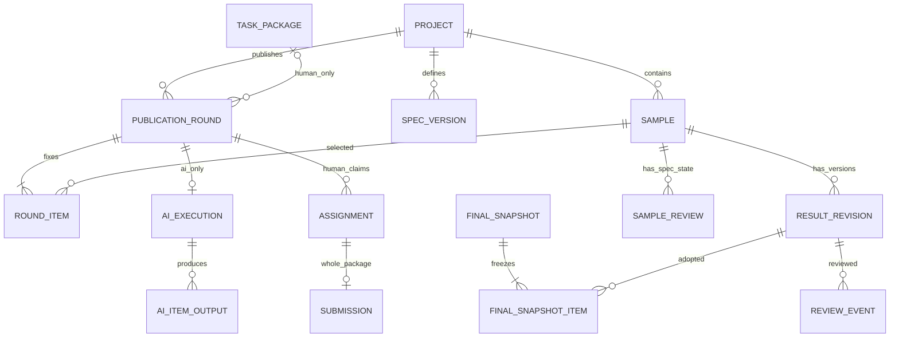

# 数据库设计｜多轮人工任务与独立 AI 批次

更新：2026-11-11。本文设计的是多任务类型共用的数据模型；具体模板和能耗时序字段见第11节及[任务插件、标注格式与工业能耗验收设计](14-task-plugins-and-energy-acceptance.md)。本文为目标设计，不是已执行的 SQL。当前 backend 分支包含 V1—V5；旧备份曾有未合入的编辑器 V6 试验迁移。新增表、列、索引和权限须通过新的迁移实现，编号由 A 核对代码分支及各环境 Flyway 历史后分配。不得直接修改已执行迁移或生产数据。

## 1. 当前迁移与变更边界

| 现有迁移 | 本地代码中已有结构 | 本轮处理 |
|---|---|---|
| V1/V2 | actor、project、规范、角色授权及幂等基础 | 保留身份，扩充业务，不复制密码 |
| V3 | 导入批次、分片、sample | 保留稳定 ID 与原图；不导入外部标签 |
| V4 | package_plan、task_package、package_item、package_slot、assignment | 改为人工专用打包/领取；新增轮次，解除阻止多轮的旧唯一约束 |
| V5 | annotation_draft、submission、submission_item | 保留人工完整提交；增加 round 归属和统一 result_revision 投影 |
| 旧备份 V6（未合入当前 backend 分支） | editor_mapping、editor_session 及外部 LS 映射 | 不作为新版迁移；若某个环境已经应用，先核对并保留历史，不直接删除或重写 |

现有 V4 同一 batch 只允许一个已发布计划、同一 actor 同包提交后永久占用旧席位；这些约束须按轮次改造。当前 V5 提交没有 AI 来源，不能为 AI 虚构 assignment 来绕过设计。数据库中的实际迁移状态以各环境的 Flyway history 为准，删除源码迁移文件不等于回滚数据库。

## 2. 数据类型与关系

业务 ID 为 UUID，身份服务 ID 保持 text；时间 timestamptz/UTC；revision 和字节数 bigint；结果 jsonb；分数用有限的 double precision 或等价受约束数值，范围 [0,1]，允许 NULL。禁止 NaN/Infinity。API 数值限制在 JavaScript 安全整数范围。FK 默认 RESTRICT，不级联清空业务历史。

## 3. 项目、包、轮次和领取

表中“新增/调整”均是待实现内容。所有冗余 project/spec/round 字段必须通过组合 FK 或同事务校验保持一致，不能仅靠前端传参。

| 表 | 字段要点 | 约束与说明 |
|---|---|---|
| actor（保留） | id、kind HUMAN/MODEL、identity_user_id、status | HUMAN 身份唯一且非空；MODEL 无人类登录 ID；不另建 AI 枚举 |
| project/spec_version（保留） | owner、task_type、revision；labels、frozen_at | 使用规范的任何发布都冻结版本，AI 同样如此 |
| import_batch/sample（保留） | project_id、batch_id、source_path、storage_key、hash | sample 与批次同项目；READY 样本不可变；同内容不同路径不自动合并 |
| result_selection（新增） | id、project_id、spec_version_id、created_by、purpose、review_action 可空、filter_json、policy_id 可空、statistics_json、selection_hash、created_at、expires_at | PUBLISH/REVIEW/FINALIZE固定选择；集成另用aggregation_input，不是动态查询表达式 |
| result_selection_item（新增） | selection_id、project_id、sample_id、result_id 可空、review_revision、ordinal | 唯一(selection,sample)；ACCEPT/FINALIZE时result必填；PUBLISH/NEEDS_REVISION可空；无审核行revision=0 |
| package_plan（调整） | project_id、spec_version_id、selection_id、package_size、annotators_per_sample、selection_hash、status | 新计划按选定样本，不强制单一 batch；默认 10/1，同一 selection 可多次规划但活动样本不得重复发布 |
| task_package（调整） | plan_id、project_id、spec_version_id、sequence_no、sample_count、status | 人工工作单位，不承载所有 AI 业务；成员冻结，旧包不得重新塞入新样本 |
| package_item（调整） | package_id、project_id、sample_id、ordinal | 唯一(package,sample)、(package,ordinal)；不再强制所有样本来自同一 batch，样本原批次仍保留 |
| publication_round（新增） | id、project_id、spec_version_id、package_id 可空、round_no、mode HUMAN_POOL/AI_AGENT、instructions、status OPEN/CLOSED/CANCELLED、revision | 人工必须有包；AI 必须无包；人工唯一(package,round_no)，同包至多一个 OPEN round |
| round_item（新增） | round_id、project_id、spec_version_id、sample_id、ordinal、reference_result_id 可空 | 唯一(round,sample)、(round,ordinal)；人工必须等于包的全部成员；AI 任意同项目兼容样本；发布后不可变 |
| sample_work_claim（新增） | project_id、sample_id、round_id | PK(project,sample)；发布时占用，轮次结束删除占用行；不是删除历史。多个同轮人工席位共用占用 |
| package_slot（调整） | id、round_id、package_id、slot_no | 唯一(round,slot_no)，不再唯一(package,slot_no)；每轮完整 1..N |
| assignment（调整） | id、round_id、package_id、slot_id、actor_id、status、revision、ended_at | 仅人工，slot/round/package 一致；同一 actor 在同轮不可重复领取 |

result_selection 的“全选筛选结果”由后端在一个一致快照内生成 item 清单；返回实际数量和 hash，分页预览此清单。超量拒绝或通过持久任务生成，不能跨多次普通分页查询拼出漂移集合。

新人工包可以从同项目不同导入批次/旧包选样，但必须使用一份规范。旧 package_item 的 plan/batch FK 不能原样套给新跨批次计划：迁移时新增 project/spec 组合归属、回填，再解除单批次依赖，保留 sample.batch_id 追溯。唯一(plan,sample)可继续用于防止同一打包计划重复分包。

## 4. 人工草稿、提交与统一结果

| 表 | 字段要点 | 约束与说明 |
|---|---|---|
| annotation_draft（调整） | assignment_id、round_id、package_id、sample_id、result_format、result、explicit_done、revision | PK(assignment,sample)；同时绑定 assignment 及 round_item，只有包成员 FK 不够 |
| submission（调整） | id、assignment_id、round_id、project_id、package_id、spec_version_id、submitted_by、content_hash | assignment 唯一；必须绑定本轮和作者；不可变 |
| submission_item（调整） | submission_id、round_id、sample_id、draft_revision、result | 完整快照；样本必须是该 round_item，不只是原包成员 |
| result_revision（新增） | id、project_id、sample_id、spec_version_id、source_kind、source_actor_id 可空、submission_id/ai_execution_id/aggregation_id/owner_edit_id、result_format、result、confidence 可空、created_at、content_hash | 每条为不可变候选；四种来源只能有一种且匹配 source_kind；人工/AI 不共用唯一 marks |
| result_reference（新增） | result_id、project_id、sample_id、spec_version_id、reference_result_id | 同样本/规范的来源引用；保留人工参考 AI、owner 修改等关系；禁止自引用，新增结果只引用既有不可变版本 |
| owner_edit（新增） | id、project_id、sample_id、spec_version_id、actor_id、base_result_id、reason、created_at | owner 修订必须基于存在的候选，新结果默认 PENDING，不暗中审核通过 |

source_kind 为 HUMAN/AI/OWNER/AGGREGATION。来源字段建议显式 FK 加 num_nonnulls(...)=1 CHECK，而不是一个无法建外键的 source_id。HUMAN 的 source_actor 必须等于 submission.submitted_by；AI 必须等于 execution.agent_actor_id；OWNER 必须为该操作有权限的 owner；AGGREGATION 不是伪造的标注员，来源身份可为空，另记录触发人。

HUMAN结果还应通过(submission_id,sample_id)关联submission_item，AI结果通过(execution_id,sample_id)关联成功的ai_item_output；候选内容必须来自对应固定输出，不能只验证父记录存在。

唯一(submission_id,sample_id)、(ai_execution_id,sample_id)、(aggregation_id,sample_id)、(owner_edit_id)分别防止来源重复投影。只有 AI 来源可带模型 confidence，人工修改及集成不继承 AI 分数。模型版本从执行记录取得，不信任浏览器。

人工草稿允许包内只有部分样本完成，但草稿本身不构成正式交回。每个 assignment 对应一个领取包；提交事务必须验证请求 sample/revision 集合恰好等于该 assignment 在本轮领取的包成员，每条草稿 explicit_done=true 且内容有效，不能漏项、重复或加入包外样本。同一发布计划的其他包不属于本次提交校验范围，可以稍后提交；例如 10 个包可先分别提交其中已完成的 5 个。单个包内有任一样本未完成就不能为该包生成 submission。重新发布的选定人工范围应先拆成包，各 assignment 再独立校验。提交与 result_revision 投影同事务完成；旧记录回填也建立唯一来源，避免查询期双写成两份答案。

## 5. AI 执行与结果快照

| 表 | 字段要点 | 约束与说明 |
|---|---|---|
| ai_agent_config（新增） | actor_id MODEL、task_type、capabilities、model_version、config_ref、enabled | 数据库保存受控配置引用，不在前端暴露密钥；模型是否支持参考输入显式声明 |
| ai_execution（新增） | id、round_id 唯一、project_id、spec_version_id、agent_actor_id、model_version、config_version、label_mapping、confidence_description、status、generation、lease_owner/lease_until 可空、started/ended_at、retry_of_execution_id 可空、success/failed/pending/cancelled counts | 无 package/assignment；RoundItems 为执行全集；终态不可重开 |
| ai_item_output（新增） | execution_id、round_id、sample_id、status SUCCEEDED/FAILED/PENDING/CANCELLED、result 可空、confidence 可空、error_code 可空、generation、attempt_count | PK(execution,sample)；FK 绑定 execution 和 round_item；成功时有效标签必填，失败不填虚假答案 |
| ai_result_snapshot（新增） | id、execution_id 唯一、model_version、input_hash、created_at、counts | 执行结束时固定成功 result_revision、失败清单及计数；PARTIAL 时两者都必须齐全；未结束不得创建审核策略 |
| ai_result_snapshot_item（新增） | snapshot_id、execution_id、sample_id、result_id 可空、outcome、error_code 可空 | 每个输入样本恰有一行；成功绑定该 execution 的结果，失败/取消未完成结果为空 |
| confidence_policy（新增） | id、project_id、execution_id、snapshot_id、model_version、lower_threshold、upper_threshold、created_by、created_at、revision | CHECK 0≤L<H≤1；保存策略追加版本，不修改旧审核使用的策略 |

AI 批次的终态表示执行已交回，不代表需求方已审核通过或项目已完成。失败清单和成功候选属于同一个不可变批次快照；需求方可以先核查、修正或确认成功结果，再单独决定失败项重试、换 Agent 或转人工。审核记录不能修改 AI 原始输出。

Worker凭据绑定workerId及Agent授权；执行输入配置和标签映射创建时固定。租约默认120秒、30秒心跳，详见04第7.3节；已写入成功/失败输出不可覆盖，接管保留原输出，旧generation写回拒绝。

Worker 在短事务原子认领租约并递增 generation，事务外调用模型，写回时检查 generation、actor/project 状态、样本范围和执行状态。租约过期接管可以重复计算，不能重复采纳。取消递增 fencing generation，使旧工作者写入失效。

批次终结需所有输入有成功、失败或取消未完成结论：全部成功为 SUCCEEDED，部分成功为 PARTIAL，全失败为 FAILED；主动取消为 CANCELLED 并保留有效已得结果。事务生成 snapshot、候选 result_revision、终态及统计；结果量超过同步事务上限应明确拒绝或采用不可见 staging 后原子发布，不边发布边审核。

成功候选可经需求方审核，即使批次 PARTIAL。失败无答案，不能进入审核集合。重试已终结批次由 owner 选择失败项创建新 execution/round，retry_of_execution_id 关联原执行，不覆盖原模型版本或结果快照。

## 6. 当前审核、集成和成果

| 表 | 字段要点 | 约束与说明 |
|---|---|---|
| sample_review（新增） | project_id、sample_id、spec_version_id、selected_result_id 可空、status UNREVIEWED/PENDING/NEEDS_REVISION/ACCEPTED、revision | PK(project,sample,spec)；ACCEPTED 必须有对应 selected_result；无候选时可 UNREVIEWED 或 owner 指定 NEEDS_REVISION |
| review_event（新增） | id、project_id、sample_id、spec_version_id、actor_id、action、previous/result_id 可空、reason、policy_id 可空、selection_id 可空、before/after_revision、created_at | 追加且不可变；只有 owner 的明确动作生成审核决定，执行者不能自审 |
| aggregation_run（新增） | id、project_id、spec_version_id、algorithm/version、parameters、requested_by、status、input_hash、created_at | 固定整批输入，不从实时“最新答案”推断 |
| aggregation_input（新增） | run_id、sample_id、result_id、source_actor_id | 样本与规范相同；同一样本同一来源 actor 至多一份选定答案 |
| aggregation_output（新增） | run_id、sample_id、status、suggested_label_id 可空、vote_counts、valid_vote_count、result_id 可空 | 有严格多数才生成 AGGREGATION 候选；少于两票或无多数保留原因，不造答案 |
| final_snapshot（新增） | id、project_id、spec_version_id、scope_hash、created_by、created_at | 只固化明确范围；不强制 packageId，不能表示未选样本也完成 |
| final_snapshot_item（新增） | snapshot_id、project_id、sample_id、spec_version_id、result_id、review_event_id、review_revision、source_path、content_hash | 每样本一条；记录创建时有效确认依据；不可变 |
| export_job（新增） | id、project_id、requested_by、status、format、include_originals、storage_key/checksum 可空、expires_at 可空 | 创建时固定 final_snapshot 清单，不从 submission 直接导出未审核结果 |
| export_job_snapshot（新增） | export_id、project_id、snapshot_id | 同项目 FK；多个快照重叠样本若选择不同答案则拒绝，禁止静默择新 |
| audit_event（新增/完善） | actor/project、action、resource、reason、request_id、created_at | 与状态写入同事务追加，不写密码、Token、密钥 |

确认必须指定具体结果版本和当前 reviewRevision；更改阈值不会改变 ACCEPTED。重新发布已确认样本时 owner 先显式同意，发布事务内写撤销当前确认事件、推进 revision，历史 final_snapshot 不被重写。旧快照仍是当时成果，不代表最新状态。

成果创建时以稳定样本顺序检查所有选中样本已 ACCEPTED、答案合法、没有活动占用，生成快照。人工包完成状态可以引用快照，但 AI-only 成果无需人工包。项目仍有其他未完成样本时，不把项目显示为全部完成。

## 7. 归属约束与唯一性

以下组合外键必须有对应 UNIQUE 键；具体 DDL 由迁移实现，不能用 nullable FK 绕过 mode/source CHECK。

| 引用链 | 保证 |
|---|---|
| round(project,spec) → spec(id,project) | 本轮规范属于项目 |
| round_item(round,project,spec) → round(id,project,spec)，(sample,project) → sample(id,project) | 样本与轮次同项目 |
| round_item(reference_result,sample,project,spec) → result_revision(id,sample,project,spec) | 引用同样本规范的固定结果 |
| assignment(slot,round,package) → package_slot(id,round,package)，slot(round,package) → round(id,package) | 人工席位绑定本轮包 |
| draft/submission_item(round,sample) → round_item(round,sample)，submission_item(submission,sample) 与 assignment 包成员关系 | 只能提交本 assignment 所属包内样本；包内必须完整，其他包不纳入本次提交 |
| submission(assignment,round,package,author) → assignment(id,round,package,actor) | 作者及范围不能伪造 |
| ai_item_output(execution,round) → ai_execution(id,round)，(round,sample) → round_item | AI 不能写范围外结果 |
| result_revision 的来源组合 → submission/ai_execution/owner_edit/aggregation_run | 来源、项目、规范、作者一致；服务及必要触发器核对样本来源 |
| sample_review(selected_result,sample,project,spec) → result_revision | 不能审核另一张图的答案 |
| snapshot/review/selection 的 result 组合外键 | 审核、选择与导出不得跨项目或替换样本 |

将旧 uq_assignment_actor_package_reserved 替换为 (round_id,actor_id) 的有效态唯一索引；slot 改为轮次席位。已提交占用本轮席位，但不阻止下一轮新席位。新计划取消 uq_plan_published_batch，发布幂等按计划 ID/hash 管理，跨计划冲突由 sample_work_claim 保证。

锁持有期间由服务验证人工 RoundItems 与 package_item 集合完全相等，AI round 没有人工包，source_actor 类型正确；对不可变结果/快照限制业务账号 UPDATE/DELETE 权限。应用账号不能修改保护触发器和迁移历史。

## 8. 事务、锁顺序与幂等

统一顺序：幂等记录 → 涉及 actor（按 ID）→ project → spec → sample（按 ID）→ sample_review（同序）→ selection/plan/package → round → slot → assignment 或 ai_execution → draft/output → 不可变结果、审核事件和快照。只拿需要的锁；可预读定位 ID，拿锁后复核。Worker 禁止先锁 execution 再倒锁 project/sample。

- 正常写请求 actor/project 用共享锁；停用/暂停用排他锁；人工发布首次 DRAFT→OPEN 用项目排他锁，避免锁升级死锁。
- 发布、再发布、审核与最终成果对受影响 sample 行按稳定顺序排他锁，解决 review 行尚不存在和样本占用插入的竞态；sample_work_claim 唯一键兜底。
- 保存持 assignment 共享锁，首次转 IN_PROGRESS 直接用排他锁；草稿 CAS revision。提交/释放用 assignment 排他锁，提交按 sample 顺序固定所有草稿。
- AI 结果写回持执行状态保护锁、检查 generation；终结/取消取排他锁。锁只覆盖数据库校验和写入，不覆盖模型运行。
- 选择快照用 REPEATABLE READ 一致短事务；消费时仍验证 reviewRevision 和当前授权，过期全部拒绝，不把旧预览当作永久授权。
- 发布与撤销当前确认、占用、持久任务创建在同一事务完成。队列记录与发布同时提交，避免已发布却无工作。
- 审核全有或全无；有一个过期项返回 REVIEW_CONFLICT，给出需刷新范围，不部分成功却显示全成功。
- AI 终结结果只在快照完整落库后可审核。导出在数据库外生成文件，校验后才标 SUCCEEDED。

40P01/40001 最多有限次重试整个数据库事务并退避；23505 按约束区分幂等、占用和重复领取；不重试所有错误，不在重试闭包中调用模型。Idempotency-Key 绑定调用者、操作路径、键和请求 hash，同内容重放同响应，同键不同内容 409。

## 9. 迁移、回填与恢复

1. A 先列出各环境实际 Flyway 历史，分配新编号；不得修改已执行迁移文件或清空库来跳过升级。
2. 新增 round/结果/审核/AI 表和兼容列；回填旧包为人工首轮，现有 assignment/slot/draft/submission 加入 round 归属。
3. 回填旧正式提交到 HUMAN result_revision，来源唯一；旧草稿仍是草稿，没有 owner 审核证据的旧答案为待审核，不自动 ACCEPTED。
4. 建立新组合 FK 和索引、校验计数后，再解除旧单批次/单包永久席位约束；更新 ORM/SQL 查询同步上线。不能先删旧约束而不加新归属保护。
5. 旧活动包回填 sample_work_claim；若历史不同活动包存在同样本冲突，停止迁移并给出清单，由负责人处理，不能任意覆盖。
6. 冻结输入、结果和规范不可变；旧 package_item batch 信息保留追溯，新增跨批次计划走新 project 归属。
7. 停用外部 LS 会话路径。若环境中存在旧 V6 映射则保留数据库历史，不再新增外部项目任务；当前分支不带入旧 V6 迁移实现。
8. 隔离副本验证迁移、回填、旧接口兼容和恢复；记录源码版本、迁移清单、数据库与文件备份。验证失败不更新共享库。

导入继续遵守文件持久化后才记回执，恢复按摘要核验；业务库、原图、模型版本配置、成果文件和队列一并考虑恢复。已确认结果/原图不因导出文件过期被级联删除。备份和恢复是实施任务，本文未实际执行。

## 10. 验收重点

人工 6/10 拒绝提交、10/10 成功；100 包独立提交；第二轮子集完整提交；同一样本人工/AI 重叠发布拒绝；AI 无 packageId 可完成 PARTIAL 并审核成功候选；暂停/取消后迟到写入拒绝；reviewRevision 冲突拒绝；改变阈值不改变旧审核；AI-only 成果可导出；结果、审核、导出跨项目全部拒绝。具体团队验收见 05。

## 11. 任务插件、类型化输入与质检的结构增补（目标设计；迁移状态另行核对）

公共数据库模型保存项目、样本身份、导入来源、执行者、轮次、结果来源、审核、质检和成果等通用关系。每种插件的领域内容通过有版本标识的类型化输入/结果承载；不要为每种数据类型复制一套项目、任务、用户和提交表。结构化 JSON 必须同时保存格式/schema 标识并由对应插件校验，不能仅靠一个 task_type 字段推断任意 payload 的语义。

- spec_version固定template_id/version、input/result_schema_id及摘要；现有schema_version不能同时充当模板版本、输入版本和结果版本。注册表先随代码发布，数据库保存冻结规范，不要求先建插件商城表。
- sample增加的input_format、input_payload、input_hash、source_key等字段应作为模板无关的承载结构；能耗插件可将一站点日映射为一个样本，但这只是该插件的工作单元规则。图片、文本或其他数据使用各自输入schema，不把station_key、日期、24小时值写入公共样本列。同一输入版本不可变，插件负责稳定来源键和重复识别。
- source_asset保存一次原始CSV及project/batch/hash归属；sample_source关联样本与资产、切片选择器，组合外键防跨项目。一个样本可以同时依赖小时、日值、历史上下文，授权按样本切片，不能直接把公共CSV存储键暴露为领取者fileUrl。
- annotation_draft及result_revision保留归属、来源及不可变约束；通过新增迁移扩展V5单一result_format限制，旧分类结果不原位改写。结果校验按冻结模板分派，不能取消CHECK后接受任意JSON。
- 新增固定质检计划/样本清单、金标准版本、统计快照；质检范围与母体/随机种子/规范绑定。多人利用现有席位扩展，历史修订不重复计票，金标准答案对盲标者和被评测Agent隐藏。具体DDL与质量接口须补齐后实施。

时序输入的时间/单位、点与半开区间、缺失及上下文语义属于对应插件的schema，由14给出当前能耗样例。此处为通用数据库目标设计；实际迁移状态需检查工作区迁移文件及各环境Flyway历史，不能仅凭文档判断已部署。
