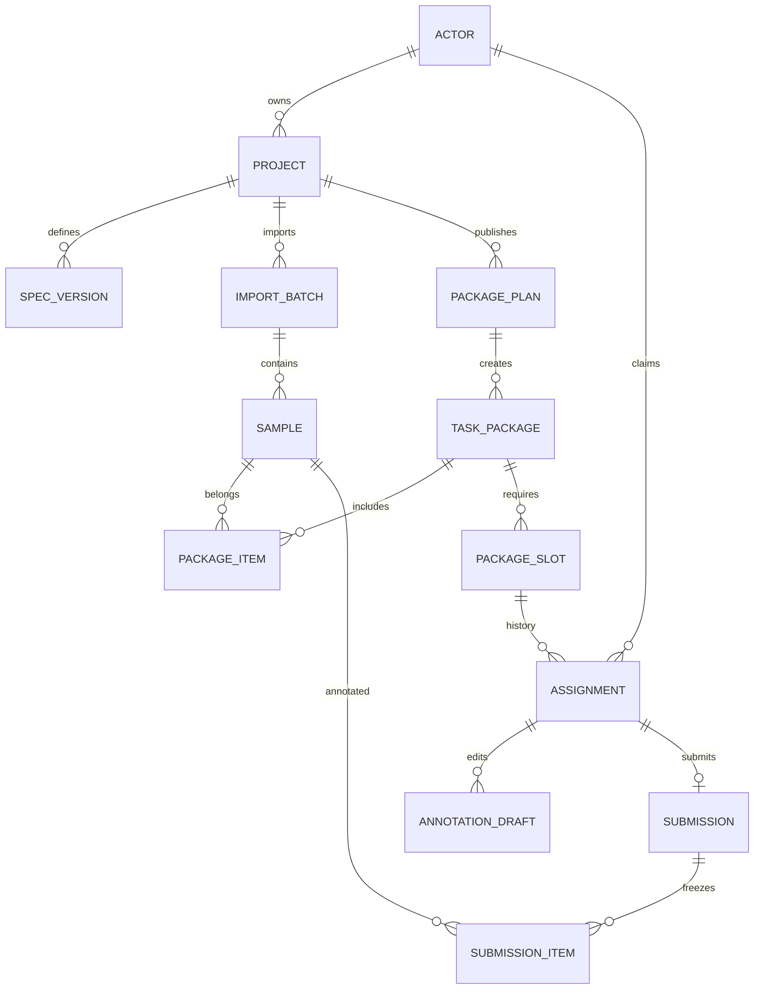

# 数据库设计草案

目标：PostgreSQL专用库。以下为逻辑表与约束，不是已执行DDL；正式迁移需按首期任务模板评审。业务ID建议UUID，API统一以字符串传递；时间timestamptz/UTC，文件大小bigint，结构化结果jsonb。引用关系默认禁止级联删除业务记录。

## 1. 实体关系



N=2不复制样本文件，而为每包创建2个slot。每个slot可有历史领取，但同一时刻仅一份有效或已提交领取。每次重新领取使用新assignmentId。

## 2. 表与字段

以下id、外键为uuid，status/kind按枚举校验，created_at/updated_at为timestamptz；字段标为可空才允许NULL。用户名仅作展示，identity_user_id才是身份关联键。

| 表 | 主要字段 | 关键约束/索引 |
|---|---|---|
| actor | id、kind(HUMAN/MODEL)、identity_user_id(text，可空)、display_name、status(ENABLED/DISABLED) | HUMAN必须有identity_user_id且唯一；MODEL必须为空。V1仅人工actor |
| actor_role_grant | actor_id、role_code、granted_by、created_at | 主键(actor_id,role_code)；V1仅LABELING_ADMIN；不是训练角色 |
| project | id、owner_actor_id、name、description、status、visibility、revision | owner外键actor；索引(owner,status,created_at)；建议V1 visibility=PLATFORM |
| spec_version | id、project_id、version_no、task_type、labels(jsonb)、instructions、editor_config、schema_version | 唯一(project,version_no)；被发布计划引用后禁止更新 |
| import_batch | id、project_id、status、original_name、storage_key、size_bytes、received_bytes、sha256、error_code(可空) | 索引(project,status)；状态UPLOADING/PROCESSING/READY/FAILED；长度非负且received不超过size |
| sample | id、project_id、batch_id、source_path、storage_key、content_sha256、media_type、metadata(jsonb) | 唯一(batch,source_path)；batch必须属于同project；同内容不自动合并不同样本 |
| package_plan | id、project_id、batch_id、spec_version_id、package_size、annotators_per_sample、status、selection_hash | batch/spec必须同项目；size/N均>0；V1同一batch仅允许一个正式发布计划 |
| task_package | id、plan_id、sequence_no、status、sample_count、required_count、revision | 唯一(plan,sequence_no)；required_count复制计划N且冻结 |
| package_item | package_id、plan_id、sample_id、ordinal | 主键(package,sample)；唯一(plan,sample)与(package,ordinal)，保证同批次发布无重复样本；package必须属于plan |
| package_slot | id、package_id、slot_no | 唯一(package,slot_no)；slot_no为1..N，由发布事务创建，发布后不直接增删 |
| assignment | id、slot_id、package_id、actor_id、status、revision、claimed_at、ended_at(可空)、release_reason(可空) | slot必须属于package；见下方两项部分唯一约束 |
| annotation_draft | assignment_id、sample_id、result_format、result(jsonb)、explicit_done、revision、saved_at | 主键(assignment,sample)；校验sample属于领取的包；revision从1递增 |
| submission | id、assignment_id、spec_version_id、submitted_by、submitted_at、content_hash | 唯一assignment；提交人必须等于assignment.actor_id；规范必须是包绑定版本 |
| submission_item | submission_id、sample_id、draft_revision、result_format、result(jsonb)、explicit_done | 主键(submission,sample)；成员必须与包完全一致，不可增删；结果冻结 |
| editor_mapping | assignment_id、sample_id、provider、external_project_id、external_task_id、sync_status、external_annotation_id(可空)、result_hash(可空) | 主键(assignment,sample,provider)；外部引用用字符串；无成功映射不能冒充编辑器就绪 |
| export_job | id、project_id、requested_by、status、format、selection(jsonb)、storage_key(可空)、checksum(可空)、error_code(可空) | selection保存确切submission ID/摘要；索引(project,created_at) |
| idempotency_record | actor_id、method、route、key、request_hash、response_status、response_body、created_at | 主键(actor,method,route,key)；请求摘要不一致拒绝复用 |
| audit_event | id、actor_id、project_id(可空)、action、resource_type、resource_id、reason(可空)、created_at | 追加记录；索引(project,created_at)；不得记录Token/密钥或完整原始数据 |

数据类型细节：name/title建议varchar(200)，外部ID/路径使用text，revision/version_no/计数integer；结果JSON不存原始图片字节。storage_key不可作为直接公开文件地址。上传offset与结果revision在API中也是整数。

## 3. 必须落地的约束

assignment的两项PostgreSQL部分唯一索引草案：

```sql
CREATE UNIQUE INDEX uq_assignment_slot_reserved
ON assignment(slot_id)
WHERE status IN ('CLAIMED', 'IN_PROGRESS', 'SUBMITTED');

CREATE UNIQUE INDEX uq_assignment_actor_package_reserved
ON assignment(package_id, actor_id)
WHERE status IN ('CLAIMED', 'IN_PROGRESS', 'SUBMITTED');
```

已提交席位不释放，防止同一slot重复完成。同一人放弃后可以重新领取，但生成新assignment，旧草稿不转交。V1同一批次只发布一次；未来重标批次另建版本，不修改旧包。

跨项目/跨包一致性尽量用组合外键落实：sample(batch_id,project_id)→import_batch(id,project_id)，package_item(package_id,plan_id)→task_package(id,plan_id)，assignment(slot_id,package_id)→package_slot(id,package_id)。为被引用组合建立唯一键。草稿/提交的包成员校验必须在持锁事务内完成；不能只检查传入sampleId存在。

## 4. 关键事务

- 发布：锁定READY批次与计划，冻结样本排序/规范版本；按确定顺序生成包、成员及N个slot，整体原子可见。大批量后台构建时BUILDING不可领取，完成后统一发布。
- 领取：锁包并复核项目/包开放 → 查本人无有效或已提交领取 → 锁空slot → 新建assignment → 写审计。并发失败返回409；不能依赖应用内锁。
- 草稿保存：锁assignment并确认本人有效、项目开放；校验sample属于包、规范一致；按baseRevision更新。首次baseRevision=0，重复/过期revision报409。
- 提交：锁assignment和全部相关草稿；校验客户端revision清单等于完整包成员，逐条explicit_done=true且结果合法；原子生成submission/items，assignment改SUBMITTED。与回收冲突时仅一种终态成功。
- 放弃/回收：锁assignment，拒绝SUBMITTED；改终态，旧草稿保留，唯一索引释放slot。原用户后续保存/提交失败。
- 导出：创建任务时冻结提交ID清单和状态清单；后台只读这些快照，不在下载时重新选“最新结果”。

默认锁顺序：project → package → slot → assignment → draft，涉及多行按ID排序，减少死锁。暂停、发布、领取和提交都遵循同一顺序；死锁或事务冲突作为可重试错误处理。

## 5. 状态、保留和演进

不为需求方设置REQUESTER全局角色、不存isRequester作为审批开关；创建者就是项目owner。未来协作管理可增加project_member，未来审批可以新增project_creation_request；均不改变训练roles表。

首期不提供物理删除已发布项目、样本、提交的接口，采用暂停/归档；存储保留和清理周期另定。草稿、提交、原始文件、导出分别有保留策略；备份需同时覆盖业务库、原始文件和编辑器映射，不只是源码。

未来准确度存独立评估记录（任务类型、方法版本、样本量、来源），未评估为空；融合结果另表并引用个人submission_item；模型运行另表引用MODEL actor。V1不提前创建无实际使用的融合或模型任务表。
