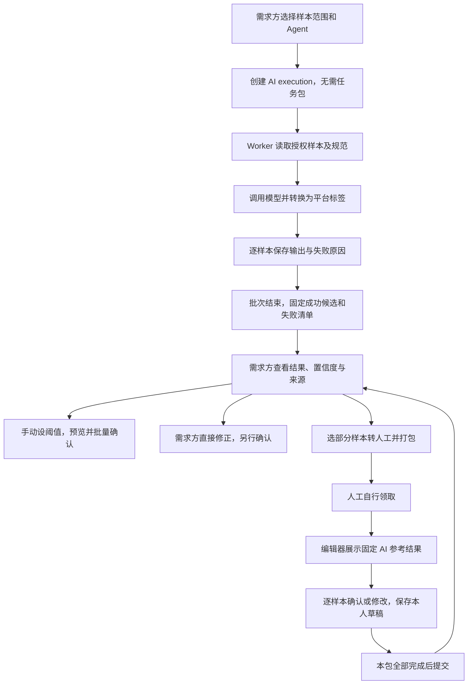

# 编辑器与 AI 接入｜人工编辑、自动标注及结果流转

更新：2026-11-10。新增时序任务插件见[任务插件、标注格式与工业能耗验收设计](14-task-plugins-and-energy-acceptance.md)；下文ClassificationEditorProps是图片模板已有约定，不能直接代表所有任务。负责人：D 实现编辑器和 AI 模型适配，C 接入统一前端及需求方工作台，A 管理执行授权、结果与审核，B 提供样本、结果筛选与统计。本文件替代原服务式接入说明；是待实施契约，不表示当前代码已经完成替换。

## 1. 边界与现有代码差距

仅复用适合当前任务的 Label Studio 编辑器代码、控件和必要样式，作为统一前端中的组件构建与发布。禁止为新版部署启动完整 Label Studio 服务；不创建外部项目/任务，不访问其数据库，不通过 /api/projects 或 /api/tasks 保存标注，不向浏览器发送共享管理员 Token。

旧备份中的 AssignmentEditorService/LabelStudioClient、editor-sessions/editor-sync 和 V6 editor_mapping/editor_session 依赖外部 LS 服务；这些试验实现未合入当前 backend 分支，不能仅更名便认为满足新要求。当前前端已有自己的分类选择与草稿接口，新版应替换为统一编辑器适配，避免两个控件争写同一答案。

保留有用的图片分类校验、标签转换和授权思想，迁移保存主链路到自己的 ResultService。旧映射和历史数据保留，本次文档更新不删除目录、数据库或服务。

## 2. C 与 D 的分界

| 内容 | D | C |
|---|---|---|
| 编辑器代码 | 选择固定代码版本，裁剪分类能力与资源，保留许可声明 | 将其接到现有前端构建，不重复复制一套应用 |
| 编辑器适配 | 将平台标签、草稿和参考答案转换为控件输入；将输出转换回稳定 labelId | 提供加载状态、切图、布局和提示 |
| 网络请求 | 使用宿主注入的保存回调；不偷偷请求外部LS | 使用现有鉴权请求层读图、读草稿、保存与完整提交 |
| 状态 | 正确报告 dirty、saving、有效性及保存后的revision | 禁止保存中切图或提交；显示冲突和实际成功状态 |
| 提交 | 只产生单样本编辑结果，不提交包、不审核 | 逐包调用已有submissions，后端仍做完整校验 |
| 权限 | 尊重只读状态，不能通过组件绕过服务端 | 根据接口状态展示；A后端逐请求授权 |
| AI 执行 | Agent 能力、模型适配、队列执行、输出转换和失败记录 | 选择样本与 Agent、显示批次进度，不在浏览器调用模型 |
| AI 结果预填 | 将固定 AI 候选转换为分类控件参考输入 | 在人工领取上下文展示，不自动计为本轮完成 |
| AI 核查 | 提供实际置信度及模型版本，不决定阈值或是否通过 | owner 查看结果、设阈值、预览并显式确认；A负责审核写入 |

AI 不经过这个编辑器，也不伪造人工领取。AI 按 executionId 产生候选结果，owner 核查页面可以复用分类显示/修改控件，但调用 owner 的修订接口，不调用他人的 assignment 草稿接口。

## 3. 一条人工编辑链路

```text
任务广场领取人工包 → assignmentId
→ 读取本轮items和冻结规范（必要时全部分页）
→ 读取当前样本原图及本人草稿
→ 裁剪编辑器展示参考答案或草稿
→ 用户选择/确认类别
→ 宿主PUT本人drafts
→ 服务器返回revision，组件显示已保存
→ 包内本轮全部样本均完成
→ 宿主POST本包submissions
→ 结果只读，等待需求方审核
```

原图用平台授权接口读取二进制 Blob 后创建 object URL，不把 Bearer Token 放进URL。切图或卸载及时撤销 object URL。组件配置中不得包含原始存储路径、外部LS地址或凭据。

已有草稿优先恢复；只有没有本人草稿时才展示本轮指定的参考结果。参考结果必须明确标记“参考/待确认”，不能自动保存成 explicitDone=true；人工点击确认或修改并保存后才算完成。

同一样本重新发布产生新 round/assignment；原提交只读。编辑器不得只用 sampleId 缓存答案，缓存键至少包含 assignmentId/sampleId/specVersionId。

## 4. 组件输入与事件契约

以下 TypeScript 是团队待实现的接口约定，不是已存在组件。组件公开入口名为 ClassificationEditorAdapter，具体源文件位置由 C/D 在现有 src 下确定，不另建仓库或工程副本。

```typescript
export type ClassificationValue = { labelId?: string };
export type ClassificationDraft = {
  revision: number;
  explicitDone: boolean;
  resultFormat: 'image-classification-v1';
  result: ClassificationValue;
};
export type EditorIdentity = {
  assignmentId: string;
  sampleId: string;
  specVersionId: string;
};
export type EditorState = EditorIdentity & {
  dirty: boolean;
  saving: boolean;
  valid: boolean;
  explicitDone: boolean;
  revision: number;
};
export type SaveInput = {
  baseRevision: number;
  explicitDone: boolean;
  resultFormat: 'image-classification-v1';
  result: ClassificationValue;
};
export type SavedDraft = ClassificationDraft & {
  assignmentId: string;
  sampleId: string;
  savedAt: string | null;
};
export interface ClassificationEditorProps extends EditorIdentity {
  imageUrl: string;
  labels: ReadonlyArray<{ id: string; name: string }>;
  instructions: string;
  draft: ClassificationDraft;
  reference: {
    resultId: string;
    result: ClassificationValue;
    sourceKind: 'HUMAN' | 'AI' | 'OWNER' | 'AGGREGATION';
    modelVersion?: string;
    confidence?: number | null;
  } | null;
  readOnly: boolean;
  onStateChange: (state: EditorState) => void;
  onSave: (input: SaveInput) => Promise<SavedDraft>;
  onError: (error: { code: string; message: string }) => void;
}
```

身份与规范输入只用于绑定组件，不作为后端授权依据。onSave 的闭包必须捕获当前身份，不因切图后外层变量变化把响应写入另一张图。宿主收到响应必须校验 assignmentId/sampleId，忽略过期视图响应。

保存期间默认锁定当前输入和切图，采用最简单可靠的单次在途请求；不得同时触发自动保存与按钮保存。若后续支持保存中继续编辑，需另加编辑序号，不把旧响应清除新dirty。

组件默认采用同页面受控集成，不使用旧 iframe 票据系统。确需隔离样式时使用组件级样式作用域；引入 iframe 属于实现变更，须定义同源事件校验，不直接复制旧 editor-session 方案。

## 5. 标签和结果转换

平台规范中的 labels[{id,name}] 为唯一来源。D 构建控件配置时安全转义名称与说明，使用固定模板；不执行用户上传的任意 XML/HTML/脚本。标签显示名不是结果主键。

若复用控件返回 Label Studio choices 数组，适配器只接受一条与当前 image/category 控件匹配的分类，恰好一个合法选择，并通过当前规范映射回 labelId。重复、未知类别、其他任务类型、额外标签或损坏结构直接拒绝，不能取第一项糊弄通过。

PUT请求示例：

```json
{
  "baseRevision":2,
  "explicitDone":true,
  "resultFormat":"image-classification-v1",
  "result":{"labelId":"defect"}
}
```

defect 必须是实际规范中的稳定ID。清空选择保存未完成草稿时传 result={}、explicitDone=false。后端必须独立校验内容、标签、样本范围、项目状态、actor状态和revision；不能因为转换发生在前端就信任它。

不再要求“后端从LS回读才能保存”，因为新版没有LS服务。可信边界是本平台后端校验与写入事务；保存成功以自己的API响应和持久化读回为准。

## 6. 保存、刷新、切图与整包提交

本节统一约定两类执行结果的交回语义：

- **人工**：允许保存未完成草稿；正式提交必须覆盖当前领取包内的全部样本，并且每个样本都有有效答案。同一发布计划的包分别提交，彼此不等待：例如领取 10 个包，可以先提交其中已全部标注完成的 5 个包，其他包继续保存草稿。单个包内任一样本未完成，就不能提交该包。重新发布时先把选定的人工样本范围拆成包，再逐包领取、提交。
- **AI**：批次可部分成功。批次结束后固定成功结果和失败清单；需求方可先查看、核查或处理成功结果，再决定失败项是否重试、换 Agent 或转人工。
- **共同规则**：人工提交或 AI 批次交回都只代表执行者交付结果，不代表需求方审核通过，也不代表整个项目/任务完成。审核和最终完成必须由需求方显式操作并留痕。

| 情况 | 行为 |
|---|---|
| 首次打开 | 从本平台获取草稿；无草稿时revision=0，参考答案仅展示 |
| 保存成功 | 采用服务端revision与结果，dirty=false；只表示草稿保存 |
| 保存响应丢失 | GET草稿读回核对，不直接把客户端revision+1，不盲重放 |
| 409版本冲突 | 保留本地选择并提示重新读取；不得自动覆盖别处新版本 |
| 401/403/状态关闭 | 停止可写操作，显示登录/权限或任务状态；不自动领取新任务 |
| 切图时dirty | 询问保存或放弃；保存失败仍留在当前图，未经确认不丢编辑 |
| 已提交 | 展示本人冻结结果只读；不再写草稿 |
| 页面刷新 | 从后端恢复，浏览器状态不是唯一存储 |

领取10包、每包10张时，必须按assignment分别提交。一个包6/10只能保存草稿，不能提交该包；10/10即可独立提交，不必等待其他9包。若返工范围为4张，应先将这4张组成一个本轮包，该包4/4后提交；不能误用原包其他样本或只提交当前页面。

宿主提交前读取当前assignment完整分页成员与版本，校验本地是否有未保存内容；请求items包含该包全体sampleId/revision。后端重新校验该包完整性，按钮禁用不等于安全校验。submission成功只表示这个包已交付，不能显示“需求方审核通过”或“整个任务已完成”。

## 7. AI 标注、结果核查和编辑器衔接

本节为待实现的接入约定，沿用 [04-api.md 第7—9节](04-api.md)。AI 是独立标注员：不经过人工编辑器、不按人工包领取、不调用人工整包提交。编辑器承担人工复核与修正，模型运行由后端完成。

### 7.1 完整数据链路



人工先做也可反向处理：需求方从已提交的人工结果中选样，生成 AI 执行批次。若模型不支持参考答案，发布前提示并要求改为不带参考模式，不能把“携带参考”静默降级成从零预测。

### 7.2 AI 发布和执行接口

| 步骤 | 使用接口或内部能力 | 调用者与约束 |
|---|---|---|
| 查可用模型执行者 | GET /agents?taskType=IMAGE_CLASSIFICATION | C展示能力匹配的Agent、版本、参考支持情况；服务端再次校验 |
| 固定样本范围 | POST /projects/{id}/result-selections | owner选择全部或部分样本，保存规范和参考版本 |
| 发布自动标注 | POST /projects/{id}/ai-executions | owner传selectionId、agentId、specVersionId、referenceMode；带幂等键，不要求packageId |
| 查询进度 | GET /ai-executions/{id} | C展示QUEUED/RUNNING及成功、失败、未完成数量 |
| 查询输出 | GET /ai-executions/{id}/results | 运行中只读进度；结束后提供固定resultSnapshotId/resultId供审核 |
| 实际推理 | Worker认领execution并调用模型适配器 | D实现，凭受限内部执行权限读取，不借用人类Token或领取记录 |
| 保存候选 | A提供的统一结果写入与执行终结能力 | 校验execution、generation、sample、spec；不是新增给浏览器任意上传答案的接口 |

Agent 应有实际 MODEL actor、taskType、标签映射、模型/权重版本、是否支持参考、置信度说明和受控配置引用。当前先接一种真实图片分类模型，不能仅返回硬编码答案；不要求模型一定是大模型，也不把检测框输出冒充分类。

内部领取、心跳、授权原图、输出、finish/fail契约统一以 [04-api.md 第7.3节](04-api.md) 为准；D不直接写业务数据库。适配器下述输出是模型侧内容，工作端发送时补充generation及status，由A验证租约与归属。

### 7.3 D 与 A/B 的模型适配契约

模型调用输入至少包括：executionId、generation、sampleId、specVersionId、授权原图读取句柄、标签规范，以及可选的固定referenceResult。原图读取句柄只在后端使用，不能暴露宿主机任意路径或把长期存储密钥发给浏览器。

输出使用平台标准，不要求转成 Label Studio 的 prediction/annotation 格式：

```json
{
  "sampleId":"<UUID>",
  "resultFormat":"image-classification-v1",
  "result":{"labelId":"defect"},
  "confidence":0.87
}
```

executionId、执行者、modelVersion 和本轮来源由可信执行上下文绑定，不采信浏览器声明。模型输出的类别索引或名称，D 必须使用本次固定标签映射转换为稳定labelId；未知类别判为处理失败，不自动新增项目标签。

confidence 为所选类别的可信分数，取值[0,1]或null。模型未提供有效置信度则记录未知；不能用任务完成率代替，不能因需要高/中/低分档而自行编造数值。人工修正后生成新的人工作品，该新答案不沿用AI的分数；原AI候选的分数仍保留供追溯。

分工如下：

- D：模型能力校验、调用、标签转换、真实分数与模型版本、样本错误信息。
- B：按执行范围授权读取样本、结果分页与置信度统计，不替模型产生分数。
- A：创建execution、占用范围、校验和保存结果、冻结批次、审核与来源关联。
- C：调用公开API、展示结果和状态，不在浏览器执行模型或持有模型凭据。

### 7.4 进度、部分失败、取消和重试

AI 不受“人工整包完成才能提交”的规则限制。成功项逐样本持久化，执行终结时固定有效候选与失败清单；PARTIAL 批次的成功候选可以交需求方核查，失败项没有有效答案。运行中的输出标为provisional，不进入批量审核。

Worker 不能在模型推理期间持业务数据库长事务。写回时重查执行generation、actor、项目状态和样本范围；超时重试可能重复计算，但不得重复产生业务答案。取消或暂停后的迟到响应必须拒绝。

已结束的执行不能原地覆盖。owner选择失败/取消未完成范围后，创建新执行并关联retryOfExecutionId；换模型或把成功结果再标一次，使用新发布并明确来源。AI转人工必须由owner点击发布并打包，不自动按低分派单。

取消时保留已完成的有效候选和取消未完成范围，是否采用仍由owner判断。页面不能把“批次结束”“全部成功”或“候选已保存”显示成“已审核通过”。

### 7.5 需求方如何查看、设阈值和修正

owner结果页面必须允许packageId和assignmentId不存在，使用项目级结果/图片API展示样本。至少展示：sampleId、标签、sourceKind、executionId、模型版本、confidence或未知、resultId、reviewStatus和reviewRevision。

流程严格为：先看AI结果与分数分布 → 手动设置L/H → 预览各档样本 → 勾选并批量确认。设置阈值不触发审核。高为c≥H，中为L≤c<H，低为c<L；unknown单列，失败无结果另列。策略绑定已结束的执行结果快照和模型版本，不混用其他模型分数。

批量确认消费固定选择快照与审核版本；需求方可以排除个别高分项，也可以手动确认中低分。阈值变化不自动更改以前审核结论。标记待修正、再次发布和最终完成都由owner决定。

owner修改答案调用 POST /projects/{id}/results/{resultId}/revisions 创建新候选，再显式reviews确认；不修改AI原输出、不继承其confidence，也不调用人工assignment草稿接口。

第4节的 ClassificationEditorProps 专用于人工领取上下文，其中assignmentId必填。owner核查复用底层画布/分类控件，另用owner宿主绑定projectId/sampleId/specVersionId/resultId/baseReviewRevision，注入owner修订回调；不能填一个假的assignmentId来复用人工保存路径。

### 7.6 AI 结果转人工后的预填规则

1. owner选择已固定的AI候选并创建人工打包计划，明确referenceMode=SELECTED；发布时保存逐样本referenceResultId。
2. 人工领取后只能读取本轮指定参考答案；不能凭一个resultId任意浏览整个项目或其他人的答案。
3. 有本人草稿时优先恢复本人草稿。即使本人已清空选择，也不能因为答案为空就再次覆盖成AI标签；只有确实没有本人草稿（revision=0）时才初始展示参考。
4. 显示“AI参考结果”、原模型版本及原分数。参考标签可预填，但explicitDone保持false；人工主动确认或修改并保存后才计完成。
5. 保存结果仍是 image-classification-v1 的本人草稿；referenceResultId由后端从RoundItem绑定，不允许浏览器更换来源。AI原resultId和confidence不被覆盖。
6. 当前包内全部样本完成后才能提交；同轮多个包各自提交，已完成包可以先提交，未完成包保留草稿。owner审核新人工结果时能追溯“参考哪份AI输出、人工改成什么”。
7. 发布选择referenceMode=NONE时，不向编辑器发送AI答案、分数或可取回该答案的引用，以免独立标注变成参考标注；后端可保留流程审计关联。

示例：AI候选为正常、confidence=0.72；owner选中并发人工；人工改为缺陷并完成整包提交。原AI候选仍为正常/0.72，新人工答案为缺陷、无模型置信度，由owner确认采用。

## 8. 从现有服务式实现迁移

1. D列出实际使用的编辑器代码、资源、版本及许可，裁剪为图片分类组件；不因禁止完整服务而丢弃必要的开源声明。
2. C把适配组件接到现有任务页，注入平台API，按本文件统一输入和保存时序。
3. A确认ResultService能够识别新轮次范围，保留完整提交；B确认授权原图和资源访问。
4. 新路径在不启动完整LS服务的环境通过保存、恢复、提交验证；不将关闭LS后仍靠缓存读图当作通过。
5. 切换时关闭旧会话创建与旧会话写入。旧浏览器调用editor-sessions/editor-sync/editor-ui写接口需明确返回停用错误（建议410 LEGACY_EDITOR_DISABLED），不后台转发到旧LS。当前尚未实现此错误码。
6. 新前端不依赖旧同步脚本、外部 LS 项目 ID 或技术作者。若某个数据库环境已应用旧 V6，则保留其迁移历史并另行规划兼容处理，不把该试验迁移重新带入当前分支。
7. 后续若需要部署与验收操作文档，应按本组件方案重新编写；旧服务式部署与验证记录不能直接用于新版部署或验收。

本次文档任务不实际停止服务、删除文件、修改密钥或部署。

## 9. C/D交付与共同验收

D交付裁剪组件、版本来源与许可清单、结果转换说明、事件/类型定义、实际模型/权重版本及标签映射、置信度口径、AI执行与失败处理；C交付人工页面、AI进度和需求方核查工作台；A审查执行授权、结果版本、审核及人工完整提交；B协助原图、结果筛选和分档统计。

必过场景：

- 未部署启动完整LS服务，仍可加载原图、分类、保存、刷新恢复并整包提交。
- 无有效领取、他人assignment、轮次外样本、暂停/撤销/停用后的迟到保存被后端拒绝。
- 同sampleId不同assignment互不覆盖；同轮多人预留时不共享草稿。
- 参考结果不自动完成；整包缺一项不能提交；多个包独立提交。
- 保存中切图、超时、重复点击、revision冲突不丢失或误写另一张图。
- owner可查看AI-only结果，并通过owner修订/审核路径操作，不伪造人工身份。
- 网络请求中没有外部LS项目/任务调用、共享服务Token或带Token的图片URL。
- 无packageId、无assignmentId也能真实执行AI，生成有效候选并由owner设阈值确认。
- AI部分失败时成功结果可审核，失败项无虚假标签；运行中结果不可审核，终结快照不可被迟到写入改变。
- AI转人工后参考可见但不自动完成；本人草稿优先、清空不被参考覆盖；不带参考模式不泄漏答案。
- 人工修正不覆盖AI原候选、不继承原置信度，整包提交后来源关系可查。
- owner修订只走owner接口；假assignment、伪造sourceKind/confidence不能绕过授权。
- 取消、超时、重试和重复回调不重复采纳结果；模型标签不兼容有明确错误，Mock不代替真实模型验收。

文档、组件存在不等于以上场景已通过；验证证据记录环境、代码版本、输入、操作和结果。接口及权限以 [04-api.md](04-api.md) 和 [03-database.md](03-database.md) 为准。

## 10. 任务插件与时序编辑器增补

平台按templateId/version和editorKey选编辑器；公共宿主提供输入、草稿、参考、只读状态与保存回调。图片模板继续ClassificationEditorProps，时序模板使用inputFormat/schemaId/inputHash及结构化payload；两者复用dirty/saving/valid、baseRevision和完整提交约定。

时序输入由受限data接口返回，不下载整份共享CSV后在浏览器筛站点。小时桶为kWh、北京时间；点定位原始时间，区间[start,end)。主标签/附加标签/点/区间进入14的类型化结果草案，真实标签体系须专家确认。D负责适配器转换和字段校验规则，A负责后端独立校验。

AI读同一冻结输入和规范，输出同样payload；规则命中依据不伪造成confidence。不存在可用历史基线时返回明确原因。owner修订另走owner接口，不借用人工assignment。

禁止通过新插件重新引入完整LS服务。Label Studio格式仅作结构借鉴；固定版本与逐类型往返转换尚待核验，不能将本平台timeseries_point/labelIds等字段宣传成LS原生格式。历史图片格式保留兼容。
