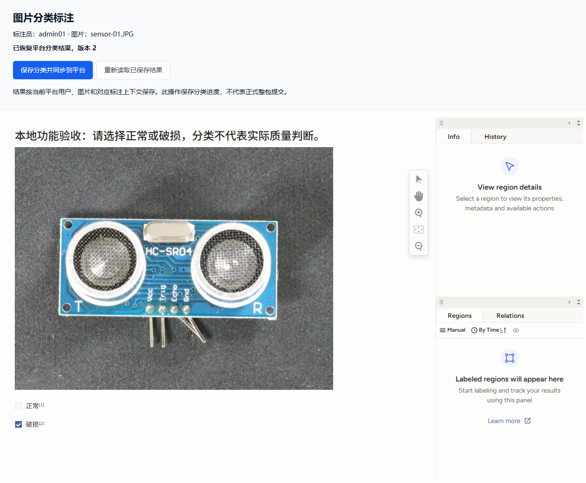
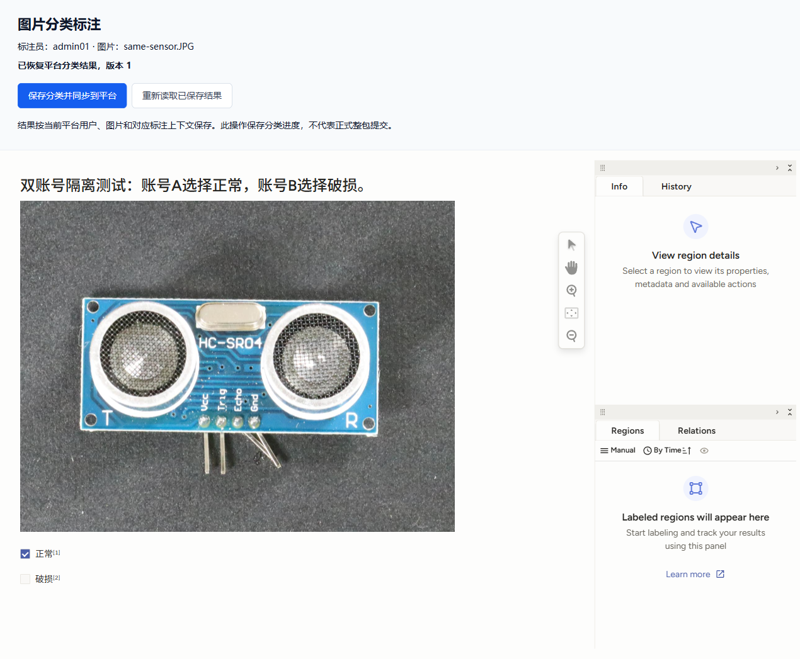
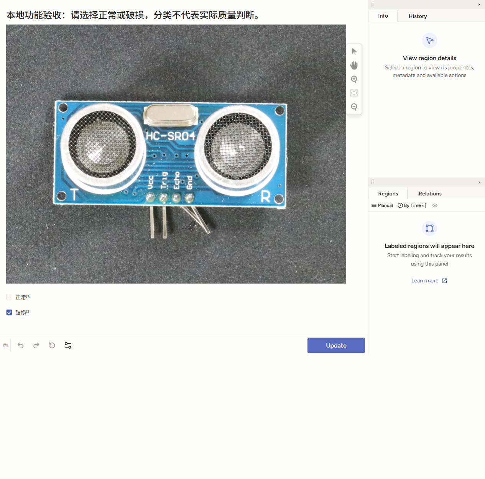

# 领取编辑器验证与评审记录

日期：2026-11-08。以产品01、架构02、数据库03、接口04及分工05为依据；业务基线为backend提交c26f90182ca2ff49d2b731ce1f09aaacf847d426。此前“本人项目直接标注”口径已废止，不能作为当前验收标准。

当前交付页面已移除自定义业务顶部，保留LS原生Submit/Update及编辑工具；最新页面回归见下方“原生控件适配与保存链路”。前两轮真实服务截图用于记录当时保存和隔离证据，含旧业务顶部，不代表当前交付布局。

## 本轮变更与代码审查

- 已在本地功能分支合入最新业务后端；ResultController、ResultService及业务V1—V5保持原实现，不重新实现草稿与正式提交。
- 删除ProjectEditorController/Service/UiController、项目直标测试和旧示例，改为AssignmentEditorController/Service、EditorUiController与领取调用示例。正式前端业务代码未修改，旧项目直标前端功能分支已移除；本次仅交付接口供正式前端接入。
- 移除本分支冲突的旧编辑器V5和项目V6。新增V6只建领取映射和会话，复用业务annotation_draft；旧迁移本地归档，旧验收库保留，未repair/删库/改历史。
- 映射由assignment＋sample＋provider唯一定位，并通过组合外键绑定领取作者及包成员；冻结规范沿领取发布计划取得。会话复合外键绑定映射及actor。
- 按actor → project → task_package → assignment顺序锁定；网络请求全部在事务外。外部写入前持久化SYNCING操作，回读后再短事务检查权限和草稿revision。
- 后端验证LS技术作者、任务、规范、图片摘要、分类内容后转换成稳定labelId；不向浏览器暴露服务凭据，不信任客户端指定actor。
- 一次性入口HMAC、摘要存储、HttpOnly路径Cookie、同源消息和未保存修改提示沿用。编辑器保存是草稿，业务提交成功才算完成整包。

## 本轮验证

本节记录最终执行结果；真实服务与模拟验证分开。运行测试使用独立临时PostgreSQL、HTTP身份桩和LS桩，不连接服务器业务库。

| 检查 | 结果 |
|---|---|
| 领取编辑器集成 | 最终11项全部通过；覆盖标准草稿保存/修改/恢复、N=2独立答案和提交冻结、未领取owner/他人领取/包外/匿名拒绝、票据与Cookie绑定、冻结规范、暂停/停用/回收、外部不确定保存恢复、迟到同步冲突、外部作者/内容异常、保存期间暂停后拒绝迟到落库 |
| 最终全量Maven clean verify | 构建成功；55项测试，53通过、2项显式可选测试跳过，无失败或错误 |
| V5→V6升级 | 独立新数据库先迁移至业务V5，保留actor数据后升级V6；V5校验值和原数据不变，应用账号授权检查通过 |
| 编辑器消息JS | 当前9项通过；平台labelId恢复、保存回执、来源校验、保存期间新修改、加载失败/状态握手、忙碌状态、原生Submit/Update和原生失败Promise |
| 前端仓库 | 未修改；本轮不声称已完成前端接入或浏览器端到端 |
| 真实LS浏览器 | 单账号保存/修改/恢复及双真实账号N=2独立标注、交叉越权验证均通过，详见下文；使用真实本地LS 1.23.2及隔离业务库，未修改正式前端业务代码 |
| 服务器 | 新增领取适配未部署到服务器。服务器既有LS实例见部署文档历史记录，本轮未复核运行状态 |

外部读回故障注入：LS已保存而GET暂时失败时，平台草稿仍为0；editor-sync只读外部答案再保存一次，答案数量不增加。并发故障注入：外部保存期间通过业务接口保存了另一份新草稿，编辑器最终同步409且原业务新草稿不被覆盖。该场景也验证外部请求未持有业务写锁。

## 真实身份与真实LS本地联调补充（2026-11-08）

被测代码提交4d2471a。本机Docker已恢复，使用已有heartexlabs/label-studio:1.23.2镜像及本地持久卷，LS监听127.0.0.1:8085；后端8088使用新的.tools/assignment-acceptance/assignment-postgres隔离库，成功从空库应用业务V1—V5及编辑器V6。没有接管旧验收库，也没有更改服务器业务数据。

通过既有本地前端登录页读取浏览器中已有的真实登录会话，后端向统一身份服务验证。真实账号参与领取后才获得编辑权限。本轮没有模拟身份或修改正式前端源码；使用本地测试脚本调用真实API，并打开返回的受控编辑器URL进行浏览器操作。测试Token和LS密码未写入报告。

| 场景 | 实际结果 |
|---|---|
| 创建项目、规范、导入两张图片副本、发布及本人领取 | 全部通过真实接口完成，仅写本地隔离库 |
| 打开真实LS组件和图片 | 浏览器JS/CSS与图片加载成功，绑定当前actor、assignment、sample及冻结specVersion |
| 第一张图片保存和修改 | 选择正常保存revision=1，改为破损保存revision=2；业务记录为image-classification-v1及labelId=broken |
| 刷新恢复 | 恢复revision=2和破损选择；同源保存通知携带正确的用户/领取/图片/规范标识 |
| 第二张图片 | 独立保存normal、revision=1，未覆盖第一张答案 |
| editor-sync | 从真实LS读回核对后返回原revision=1，不重复增加草稿版本 |
| 正式整包提交 | 提交两张图片的2/1版本清单成功，快照包含正确用户、规范及两条结果 |
| 提交后旧编辑器继续保存 | 后端拒绝；草稿及冻结提交未被覆盖 |

验收项目b7d51f42-0283-477f-9e31-770b9731f6c2，领取5722882f-bc75-4d8c-a4ee-e9bf58104201，提交442938b2-bd1a-4ff0-b9c2-a36c34824210。以上均为本地验收ID，不可直接用于服务器请求。私有详细报告保存在本机.tools/assignment-acceptance/browser-verification.json，不额外交付重复JSON。

本节是首轮单账号验证；后续双真实账号验证见下一节。自动化双人测试使用身份/LS桩，证据与实际账号测试分别记录。正式前端入口和服务器验收仍待实施。

## 双真实账号隔离补充（2026-11-08）

被测代码仍为4d2471a，无需修改业务代码。使用两个相互隔离的浏览器会话，统一身份服务确认不同actor。账号A沿用已有真实会话，账号B由用户在独立登录窗口自行登录；没有在聊天中传递或在报告中保存密码/Token。全部项目、导入、发布、领取、草稿和提交数据仅写本地隔离业务库，LS使用本机真实实例。

新建一个单样本任务包，N=2；两人分别领取不同席位，使用相同sampleId但不同assignmentId。账号A选择正常，账号B选择破损，均通过真实LS编辑器保存并刷新恢复。

| 核对项 | 实际结果 |
|---|---|
| 两人身份与任务绑定 | actor不同、assignment不同，package/sample/specVersion一致 |
| 独立答案 | A保存normal/revision=1，B保存broken/revision=1；互不覆盖，刷新恢复各自答案 |
| 双向读取他人领取items、草稿和原图 | 均404；即使A同时为项目owner，也不能绕过领取访问B的工作草稿 |
| 双向PUT他人草稿 | 均404；两人的原结果和revision不变 |
| 双向申请他人editor-sessions/editor-sync | 均404 |
| 直接访问对方已打开的编辑页面/context/image/result路径 | 不携带对方路径会话Cookie时均401，自己会话的Cookie不能用于对方会话 |
| 两人分别正式提交 | 均成功，形成两份独立快照；作者分别对应本人，结果分别normal/broken |
| 非owner标注员读取对方提交 | B读取A提交返回404 |
| 项目owner读取项目提交 | A作为项目owner可以读取B已提交结果，这是需求方查看权，不授予工作草稿编辑权 |
| 提交后重新打开编辑器 | 两份领取均409，提交后不可编辑 |

验收项目e95d666d-f8cd-446f-bc97-4c5b5da79ec7，样本993d6230-016b-3775-a848-f0a55a03f833；领取A为1119f1fc-656b-414a-831d-e5671ad860e2，领取B为593b2e3a-0a1d-477b-97c0-9ede0f1b4e94。均为本地测试ID。私有详细报告在本机.tools/assignment-acceptance/two-user-verification.json，不额外交付重复JSON。

账号A刷新后的独立答案：

账号B刷新后的独立答案：

本次结论针对平台受控编辑器及业务接口，不宣称LS社区版原生共享后台已实现同样的隔离。正式前端联调、服务器部署和线上双账号复验仍未执行；没有验证第三名真实账号超领或并发容量。

## 原生控件适配与保存链路（2026-11-08，当前本地版本）

按最新交付边界移除index.html中的自定义业务标题、身份栏、状态栏和保存/重读按钮，ui.css只保留容器基础尺寸。桥接脚本保留官方LS布局和控件，开启原生Submit/Update、底部工具栏及Undo/Redo/Reset、侧面板；不修改上游资源包，不修改正式前端源码，不增加HTTP接口或迁移。

原生onSubmitAnnotation/onUpdateAnnotation和可选labeling:save调用同一保存逻辑。平台确认后更新SDK的已保存版本并通知宿主；原生失败回调返回拒绝的Promise，交给SDK显示错误，同时通知宿主。加载失败也通过load-failed和state回传。LS Submit仍是单图片草稿保存，不触发业务整包提交。

最终验证：

| 场景 | 实际结果 |
|---|---|
| Maven clean verify及JAR资源检查 | 55项测试，53通过、2项可选跳过，无失败或错误；316个运行/许可证资源及manifest检查通过 |
| 编辑器消息单元测试 | 9项通过，含原生回调和失败Promise、宿主命令、状态握手、加载失败和dirty保留 |
| 无自定义业务顶部 | 真实iframe页面检查通过，只有LS原生组件及其模板内容 |
| 原生Undo/Redo | 撤销后恢复初始clean状态，重做后恢复未保存修改，state消息正确 |
| 原生Submit/Update | 第一张图正常保存revision=1，原生Update改破损保存revision=2 |
| 刷新恢复 | 恢复破损选择、revision=2及原生Update控件，宿主state显示dirty=false |
| 宿主消息保存 | 第二张图原生保存后，可选labeling:save继续使用同一业务revision；随后原生Update仍可保存 |
| 故障注入503 | 宿主收到save-failed，当前选择保持dirty，平台仍revision=0；恢复后原生按钮可保存 |
| editor-sync与正式提交 | 真实LS读回不额外增加revision，整包按最终版本清单提交成功 |
| 提交后的原生Update | 返回409 ASSIGNMENT_CLOSED并通知宿主，不覆盖既有草稿和提交 |

以上为当前本地UI适配后的真实身份＋真实LS验证；浏览器使用本机隔离库和测试专用宿主iframe，正式前端仓库保持干净，未部署服务器。私有详细报告为.tools/assignment-acceptance/host-control-verification.json。此前双真实账号隔离基于4d2471a验证；本次没有改授权/数据库代码，也未重新执行双真实账号浏览器测试，不把先前截图当作新布局证据。

前端接入的HTTP清单、完整消息字段、错误回传、原生Submit与整包提交区别，以及iframe示例统一见[前端接入说明](10-editor-integration.md)。本轮代码、文档和截图随功能分支交付审查；真实前端/服务器验收仍未完成。

## 固定资源构建证据

固定1.23.2组件来源提交df96d79183156e556d91825d15fa7721f1145e1a，资源包SHA-256为dc332394b0326c559c03ed093e5de261830053cbf4abe5cdeab19a838c36432d。Maven自动校验解包，JUnit逐文件验证，部署前Python检查最终JAR。包含316个运行/许可证文件及manifest。

此前资源构建专项在干净副本完成，缺CSS及压缩包损坏均被拒绝；[GitHub Linux CI](https://github.com/tssai-lab/tss-data-labeling/actions/runs/42444679554)在f151bd3提交通过。该远程CI属于改为领取前的资源专项，不能当作本次领取适配后的远程CI或上线验收。本轮未重新编译上游源码。

## 已知限制与交付状态

- 共享社区版完整后台不能满足逐领取隔离；采用受控编辑器、后端授权和独立映射，不向标注员开放共享管理后台。
- 每领取/图片一个外部LS项目，适合最小接入；规模化前需评估项目数量、清理和容量。
- PENDING导入、不唯一/错误外部答案、外部与业务草稿冲突需人工对账；没有自动修复/后台管理工具，不会盲目新建或覆盖。
- 两系统不是原子事务。保存期间被暂停/停用/回收/提交或业务草稿被更新时，最终落库拒绝，LS可能保留待核对答案。
- editor-sync只同步已由适配器预留并匹配的操作，不任意导入LS后台修改；SAVED映射重新核对时发现差异仍拒绝。
- 任务释放/回收API、导出、正式前端入口和服务器验收不由本轮冒充完成。状态拒绝有测试，真实业务管理操作仍以业务实现为准。
- 旧项目直标库不兼容新迁移主线；保持备份另建隔离库。共享库迁移须业务后端审查并按部署流程执行。

本次领取模式交付面向后端功能分支及草稿PR审查，未合并部署分支、未操作服务器。推送或创建PR不代表业务审查批准或上线验收完成；本地真实LS联调的通过范围以以上记录为准。旧前端功能分支本地已删除，远程由用户确认手动删除；备份在本地保留。本次只交付后端PR，前端开发人员负责正式入口接入。交付文档为接入说明、部署说明和本验证记录三份；原业务01—09文档保留，03/04补充本功能分支的数据库和接口实施范围。
