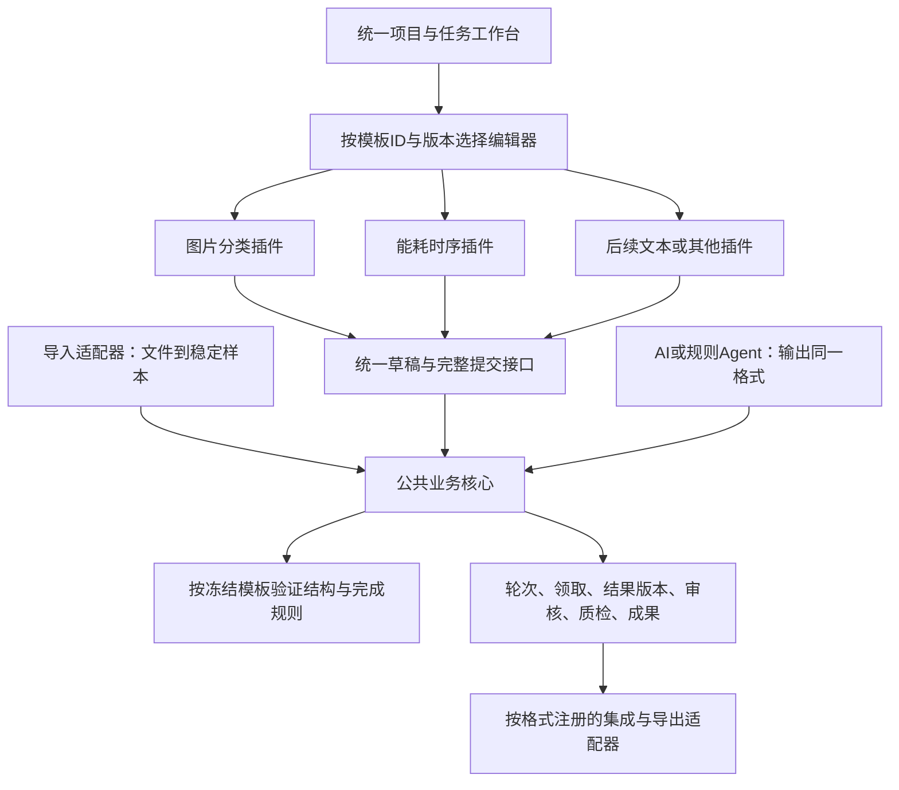

# 任务插件、标注格式与工业能耗验收设计

日期：2026-11-11。性质：通用任务插件设计、工业能耗样例需求和本地实现记录。本文件补充01—05、10、13。平台目标是通过稳定的公共流程和受控插件支持多类数据与标注任务；图片分类是现有图像样例，工业能耗时序是首个时序插件及本次验收样例。能耗数据用于验证扩展能力，不意味着平台专为能耗数据建设；不能以一个样例通过代表所有格式均已支持。本文不代表已迁移共享数据库或部署服务器。

标签、阈值、质检指标和行业交换格式的待确认项汇总在[工业能耗标注需求待确认问题](15-energy-requirements-questions.md)。未形成决议前，本文中的建议值不构成冻结规范。

## 1. 本次依据与核对结果

数据包：`energy_kwh_anonymized_20260901-20261013_v1.0.0`。本机交付位置：`/home/leriger/20261110能耗脱敏数据集(1)/`。需求依据是包内README、data_dictionary、labeling_guide，不只参考CSV。原指南明确属于建议稿，业务标签、阈值和质量目标须经业务专家确认；不能把建议当作已有金标准。

本次只读核对结果：

| 项目 | 实读结果与含义 |
|---|---|
| 文件完整性 | manifest所列14个文件的SHA-256均匹配 |
| 全量规模 | 539个站点、60个匿名企业；556,248条小时记录、23,177条日记录 |
| 时间范围 | 2026-09-01至2026-10-13，43天；北京时间UTC+8 |
| 工作单元 | 每个“站点＋日期”24个小时；23,177个站点日，全量按此生成样本 |
| 基础完整性 | 小时键/日键未发现重复；小时值未发现负值、空单元格；时间字段互相一致；小时和日表的站点日集合一致 |
| 样例任务 | 2,000行、2,000个唯一task_id和站点日，覆盖530个站点；全部能对应全量数据 |
| 初始结果 | 样例的label、label_detail、annotator、confidence、notes全部为空，符合当前只导入未标注数据的范围 |
| 零值 | 全量小时零值293,711条；2,000任务中630个全天零值。零值本身不等于缺失或故障 |
| 规模与隐私 | 文件约38MiB；不把数据、原始MD全文或真实任务结果复制到代码仓库。保留原包及校验和，输出另存 |

小时/日对账偏差等统计由交付的quality_report提供，本次未独立复算全部分布与对账指标。未发现基础结构问题不代表每个样本有正确业务标签。以下JSON均为合成结构示例，不是交付数据内容。

原包声明仅供合作方建设、测试、演示和内部评估，禁止公开再分发等用途。导出文件、截图及标注结果同样按项目权限管理，不随Git提交或公开示例发布。

## 2. 把数据包说明转成产品需求

| 来源要求 | 平台需要的能力 | 归属与验收 |
|---|---|---|
| README：时序展示与切片 | 显示24点曲线、单位、时间、日值；只加载当前样本及授权上下文 | 时序任务插件，C/D；不能用CSV文本预览代替可标注曲线 |
| README/字典：站点日任务 | 宽表一行生成一个样本；长表按站点日分组；稳定ID及源记录映射 | B导入适配；2,000样例不能变成48,000个人工任务 |
| 指南：日级标签、触发小时 | 主标签、补充标签、点位说明；区间标注作为明确可用能力再开放 | 插件输入/输出规范，D；A校验并保存 |
| 指南：近30天规则 | 同站点历史特征、规则参数版本、命中依据、缺少上下文时的状态 | B供数据/特征，D执行；不能只看24点就声称完成历史规则 |
| 指南：人工复核及裁决 | owner查看、修订、确认、再发布，记录理由 | 通用审核模块，A/C；执行者不能自行确认最终结果 |
| 指南：版本与溯源 | 原数据版本、规范版本、执行者、来源、时间、修改链、模型/规则版本 | 通用结果模块，A；所有插件共享 |
| 指南：500金标准、20%抽检 | 抽样策略、固定清单、覆盖计数、专家确认的金标准版本 | 通用质检模块，A/B/C；抽样不是随机刷新列表 |
| 指南：10%双人、kappa | 两份独立结果、盲标、同样本同规范配对、统计适用范围 | A席位/B统计/C展示；现有“只开放一人”不能满足该项验收 |
| 指南：标签集成/分歧处理 | 算法声明支持的结果字段；建议可解释；owner采用或再次发布 | B算法/A决策；投票支持率不是AI置信度 |
| 字典：企业级与设备级重叠 | 保留station_level及total_basis，企业统计不能直接相加两层 | B；属于数据解释与查询规则，不能由画图控件猜测 |
| 原包标注空列与回写 | 输入保持只读；成果导出映射到task_id、站点、日期，并带版本与来源 | B导出/A成果快照；“回写”不覆盖原始CSV |

抽检、金标准、双人独立性和一致性统计是通用需求，不能写进能耗页面后只对这个数据包有效。金标准答案仅供有权的owner/质检流程，盲标与被评测Agent不得读取。

## 3. 插件的完整边界

新任务要接入六件事：输入如何解释、编辑界面、答案结构、服务端校验、完成规则、结果导出。在原语及导入器已经支持的情况下，新增任务主要是配置和页面；遇到新文件结构、坐标体系或业务判定，则补充对应适配器。不能承诺任何任务都只换一个页面就能接入。

当前实现仍处于“用两个具体模板验证设计”的阶段：模板目录是代码内固定列表，导入器和结果校验部分按任务类型分支。下述插件声明是目标开发契约，不要误读为已经完成通用插件框架或支持任意数据格式。



| 边界 | 必须负责 | 不得接管 |
|---|---|---|
| 公共业务核心 | 身份权限、样本归属、包/轮次、领取、AI租约、幂等、审核、版本、成果 | 不在每个Controller中增加任务类型分支 |
| 任务模板/插件 | input schema、编辑器、result schema、标签/单位/坐标、完成校验、导出能力 | 不改owner权限、不自动提交包或确认成果、不另建用户/结果库 |
| Agent适配器 | 按任务模板读取输入、运行模型/规则、返回合法结果和真实证据 | 不决定最终审核、不覆盖人工结果 |
| 集成/评测适配器 | 声明支持的类型及字段、固定输入、产生统计或建议 | 不把分类投票硬套给点位/区间；不自动接受结果 |

首批模板示例为`image-classification@1.0.0`与`energy-station-day@1.0.0`。前者包装当前图片分类能力，后者用于实现和验证时序插件。它们是首批模板，不是平台可支持类型的封闭清单。模板版本包含输入、结果、编辑器及语义规则的配套版本，不能只记录前端组件版本。

第一版使用前后端随代码发布的可信注册表：后端Spring组件按ID注册，前端按同一ID选择已构建组件。注册声明由代码审查后加入，不让用户上传JavaScript/JAR/XML并即时执行；不做插件市场、远程代码热加载或为每个模板拆微服务。

业务规范冻结模板ID、模板版本、schema摘要、标签ID及说明；轮次引用冻结规范。升级模板不修改旧规范和历史结果。旧版本停止新建时仍需支持历史读取/导出；读取器不存在时明确提示不兼容，不能静默用新版本解释旧数据。

## 4. 最小插件声明与开发契约

以下是目标声明示例；ID为逻辑注册键，不是服务器路径或外部URL。

```json
{
  "id": "energy-station-day",
  "version": "1.0.0",
  "taskType": "TIMESERIES_ANNOTATION",
  "inputFormat": "energy-station-day-input-v1",
  "inputSchemaId": "energy-station-day-input@1.0.0",
  "resultFormat": "annotation-record-v1",
  "resultSchemaId": "energy-station-day-result@1.0.0",
  "editorKey": "energy-station-day-editor",
  "importerKeys": ["energy-wide-csv", "energy-hourly-daily-bundle"],
  "resultTypes": ["choices", "timeseries_point", "timeseries_interval", "text"],
  "validatorKey": "energy-station-day-validator",
  "exporterKeys": ["annotation-jsonl-v1", "energy-station-day-csv-v1"],
  "capabilities": {"references": true, "human": true},
  "enabled": false
}
```

`enabled=false`表示尚未上线。输入校验、编辑器、结果校验、完成检查和导出全部就绪后才允许新建该类型项目；AI和投票另查各自能力，不因human=true而默认支持。API返回可用模板及能力，前端未知editorKey时阻止进入可写状态并提示版本不匹配。

最小服务接口职责：

- `ImportAdapter`：受控输入文件＋固定导入配置 → 样本描述及源定位。B负责，不能自己发布任务。
- `TaskValidator`：固定规范＋样本输入＋结果 → 结构/语义错误；另检查是否满足正式提交条件。A统一调用，D提供领域校验逻辑。
- `EditorAdapter`：输入描述＋草稿/参考＋只读状态 → 本样本结果及dirty状态；通过宿主保存，沿用10的事件约定。
- `ExportAdapter`：已确认成果快照 → 可追溯文件；B实现，不能从实时草稿导出。

结构校验和完成校验分开：未完成草稿允许缺少标签；类型错误、非法标签、越界时间即使是草稿也不能保存。正式提交要求包内每个样本通过所属模板的完成检查。模板判定一条样本是否填完，公共核心判定整个包是否齐全；AI成功项也必须通过同一完成检查。

## 5. 参考Label Studio的格式思路与本平台记录

本次未联网，也没有验证某一发行版的完整导出schema。已核对本地Git历史接口示例中的Label Studio分类结构：`from_name`、`to_name`、`type=choices`、`value.choices`；此前来源记录见06。下面借鉴的是“控件/目标绑定＋类型化结果”的思路，属于本平台格式草案，不声称是Label Studio原生兼容JSON。

借鉴三点：输入对象与标注结果分开；一条样本可以有多个结果项；结果项描述目标、类型和取值。规范中的逻辑绑定名应稳定，不跟随页面组件随机ID改变。

采用两层：

1. **公共记录层**：平台保存sampleId、specVersionId、resultId、revision、执行来源、作者、模型/规则版本、时间、审核及引用关系。调用方无权伪造这些字段。
2. **任务结果层**：`resultFormat`标识格式族，`result`承载插件结果。规范记录具体resultSchemaId及摘要，公共业务按冻结规范选择校验器。

```json
{
  "baseRevision": 2,
  "explicitDone": true,
  "resultFormat": "annotation-record-v1",
  "result": {
    "schemaVersion": "1.0.0",
    "annotations": [
      {"id":"a1","from_name":"primary_label","to_name":"load_curve","type":"choices","value":{"labelIds":["spike"]}},
      {"id":"a2","from_name":"point_labels","to_name":"load_curve","type":"timeseries_point","value":{"timestamp":"2026-01-02T14:00:00+08:00","channel":"value_kwh","labelIds":["spike"]}},
      {"id":"a3","from_name":"notes","to_name":"load_curve","type":"text","value":{"text":"合成示例：需要核查该小时变化"}}
    ]
  }
}
```

示例仍经已有的`PUT /assignments/{id}/drafts/{sampleId}`调用；只有目标模板和新格式已经实现后才会被接受。AI把相同result放入内部output接口，由后端绑定执行者与来源；不为AI创建assignment。

`annotation.id`只在本结果内唯一，用于编辑对象关联，不代替业务resultId。`labelIds`是稳定标签ID，不存显示名作主键。`timeseries_point`/`timeseries_interval`是本平台拟定类型名，不宣称与LS同名标签兼容。

| 约定 | 要求 |
|---|---|
| 逻辑目标 | `to_name`必须在冻结输入schema定义中存在；本例为load_curve；`from_name`必须是模板注册控件 |
| 时间 | 原始输入采用带时区ISO8601；业务日按Asia/Shanghai划分。点定位到实际样本时间，区间采用[start,end)，明确结束边界 |
| 单位 | 小时值是该小时内的能耗kWh，不擅自改成kW；daily_kwh为独立日值，不作为第25个小时点 |
| 缺失 | 数值0、null/缺测、没有事件标注分别表达；不能填0补缺或用空答案冒充完成 |
| 坐标扩展 | 未来图像框/多边形、文本偏移均须声明坐标/偏移单位、参考尺寸/文本版本；不能只存一组无单位数字 |
| 置信度 | 平台AI confidence与人工自评分别存储。各控件分数不能默认提升为整条结果的confidence；无明确含义则null |
| 扩展字段 | 用版本化schema及受限extensions命名空间；不把任意JSON透传当作可扩展。未知核心字段/版本拒绝，不静默丢数据 |
| JSON Schema | 可沿用交付包声明的2020-12草案作为schema技术版本；还需服务端验证归属、标签、区间、完成条件和领域冲突 |

已有`image-classification-v1`及`{labelId:...}`继续可读写，不原地重写V5历史结果。新模板启用新格式；如需统一导出，显式转换并标记源格式。不得只把ResultService的单标签校验删掉就允许任意JSON。

对接LS时先列出目标版本及支持的结果类型，逐类型实现读写映射与往返样例。Label Studio使用的类别显示值与本平台labelId需通过冻结配置转换；没有映射的字段报错或保存在有定义的扩展字段，不能静默丢弃。引用格式不要求运行完整LS服务。

## 6. 能耗任务的输入、界面与标签

### 6.1 输入和样本身份

首次联调用`sample/station_day_tasks_2k.csv`，一行一条样本；随后用hourly＋daily全量文件按`station_key/date_local`生成23,177条样本，不能把556,248小时记录全部当成人工独立任务。

提供两种明确导入配置：`TASK_ROWS`读取宽表；`STATION_DAYS`读取小时/日表与必要元数据。完整目录打包上传时由配置选择主数据源，sample/preview不能同时再次导入；字典/指南不是标注答案。输入仍保持未标注，非空label列发现后提示拒绝或明确不导入答案，不能静默继承。

平台sampleId保持UUID，外部task_id和站点日为来源映射。原task_id只在对应数据集版本中唯一；不能当全局ID。相同导入重试沿用样本ID；相同项目、数据集版本、站点日经两种导入模式重复出现时须识别已有样本并报重复，不能变成两条独立投票任务。数据版本/切片策略改变则新建来源版本，不能覆盖原图表输入。

每条样本保留：源资产摘要、数据集版本、站点/企业及层级、日期/时区、24点或显式缺测、日值、源行/选择条件、输入摘要。历史统计另带contextVersion、windowStart/windowEnd、有效点数、算法版本及是否满足基线条件。

合成输入示例如下；与第5节合成结果对应，数值只用于界面与格式联调，不用来证明业务上的尖峰判定正确：

```json
{
  "inputFormat": "energy-station-day-input-v1",
  "schemaId": "energy-station-day-input@1.0.0",
  "payload": {
    "stationKey": "synthetic-station",
    "dateLocal": "2026-01-02",
    "timezone": "Asia/Shanghai",
    "dailyKwh": 186,
    "series": {
      "name": "load_curve",
      "channel": "value_kwh",
      "unit": "kWh",
      "start": "2026-01-02T00:00:00+08:00",
      "periodSeconds": 3600,
      "values": [0,0,0,0,0,0,10,12,10,10,12,10,12,14,30,12,10,10,12,10,8,4,0,0]
    }
  },
  "context": {"status": "BASELINE_INSUFFICIENT", "availableHistoryDays": 0}
}
```

完整接口另带平台sampleId和实际计算的inputHash。规则网格内缺测位置使用null并保留质量原因；时间不规则的新模板应提供显式时间数组，不能套用等间隔假设。CSV转数值需检查有限值、列类型、时间/日期/小时一致性和重复键，不能仅因为有JSON Schema文件就认为输入已校验。

### 6.2 页面

- 上方显示站点、日期、层级、单位、日值及小时合计差异。
- 中间为曲线，点选小时、缩放/拖选区间；点和区间有独立目标，已保存标记可回显修改。
- 旁边显示主标签、补充标签、命中依据和备注；已有参考答案与本人编辑结果区分。
- 有权限的历史上下文按需加载；明确展示“历史不足”“基线为零”“数据缺测”，不填造数值。
- 保存草稿、包内完成进度、完整提交沿用现有工作台；owner仍使用修订/审核入口。

### 6.3 标签及完成规则：可实施草案，发布前需业务专家确认

保留指南11个候选标签ID：normal、idle_zero、partial_zero、low_load、high_load、spike、dip、missing、meter_fault、shift_change、holiday。它们并不天然互斥，例如节假日也可能零能耗，尖峰也可能伴随高负荷。

为了对应交付CSV的主标签，建议首版设一个必填primary_label，另设可选secondary_labels及point_labels/interval_labels、备注。主标签不由数组首项或任意优先级确定；专家应确认主次标签含义及冲突规则。自动Agent遇到多规则命中，在未配置明确决策规则时记录依据并返回未决，不能擅自选一项。

初始完成检查建议：合法主标签；所有点/区间在该站点日范围内；异常定位类有对应点/区间或明确“整日疑似”说明；notes按指南填写；人工自评独立填写或明确unknown。未提供理由的不可判定样本继续草稿或交owner处理，不能伪装normal提交。是否允许业务上的“无法判断”作为正式结果，应由专家明确后加到规范，不由开发偷偷新增标签。

人工自评可用模板控件`self_reported_certainty`保存HIGH/MEDIUM/LOW/UNKNOWN，属于人工填写的结果字段；不写入公共AI confidence。指南要求置信度必填与平台允许真实分数未知的差异，应通过这一区分交业务方确认。主标签互斥/主次优先级、必要定位和自评规则未获确认前，模板只用于试标，不能当正式验收标签规范。

区间不是交付数据已存在的真实标签。界面支持区间属于扩展目标；只完成日级＋点位插件时应如实标记区间尚未验收，不能仅在manifest中列出便宣称支持。

## 7. 自动标注规则与必须明确的业务语义

| 问题 | 建议实现规则 | 不能直接假定 |
|---|---|---|
| 近30天 | 对日期d使用[d-30天,d)同站点数据，排除当前日与未来；统计窗口与算法冻结 | 该包只有43天，前30天没有完整历史；不能看未来补足 |
| 基线不足 | 输出BASELINE_INSUFFICIENT，跳过依赖历史的规则；独立规则仍可计算 | 不把缺基线判成normal |
| 日中位数/P5为零 | 记录BASELINE_ZERO；涉及比率/相对异常时不除零、不强行出阈值 | 大量零值会使P5为零，原始跌落规则可能无法触发 |
| 分位数算法 | 固定一种明确实现及插值约定，写入规则版本和证据 | 不同库默认算法可能给不同阈值 |
| 连续与时间端点 | partial_zero的06—22包含哪些小时桶、恒定值是否有容差、跨日是否连续需写进规则配置 | 不能把“22点”既当截止时刻又当22—23小时桶 |
| 班次变化 | 明确跨日比较窗口、阶跃幅度和重复次数；缺证据时未决 | 一天24点不足以证明“重复班次模式” |
| 节假日 | 用提供并确认的2026年日历版本区分假日/调休工作日，记录日历版本 | 周末不等于法定假日；本次未联网查日历 |
| 计量差异 | 确定分母、零值时差异定义、阈值及企业/设备口径 | 不擅自把差异率定义成任意一种公式 |
| confidence必填 | AI只有真实有效分数时填写，否则null＋原因；人工用独立humanCertainty | 不能把规则命中、完成率或人工自评当模型概率 |

近30天完整基线在该包内最早从2026-10-01可得到；否则需要提供更早历史或专家批准短窗口策略。宽表2,000行不是完整历史库，计算基线须关联全量文件及其授权上下文。

第一步自动化可以接真实执行的规则Agent，记录`implementationKind=RULE_BASED`及规则版本；这不是训练过的预测模型，也不能声称已有模型准确率。先验证明确规则（如24点全零）的候选输出，再补其他已确认规则；未决项作为NO_DECISION输出失败/待处理，不产生虚假正常答案。现有AI批次允许部分成功，owner仍决定是否采用。

若接学习模型，另固定权重摘要、标签映射、输入归一化、历史窗口、分数定义。Agent能力与任务模板匹配，不能用图片分类模型冒充时序模型。

## 8. 质检、金标准与多人统计

### 当前代码状态（2026-11-14）

以下代码是图片和能耗两个首批任务的具体实现/试验，不等于通用插件系统已完成；现有模板列表固定在代码中，解析和校验仍有任务类型分支。

当前后端工作区中，能耗方案仍为需求和设计；目前没有能耗导入器、模板查询控制器、结构化时序样本读取或能耗结果校验。后端已有 V1—V14 迁移，其中 V7 用于人工提交审核，并不是能耗迁移；图片分类主流程仍保留。能耗字段契约与迁移检查见 [04 的能耗首轮联调契约](04-api.md)。

计划中的能耗样例路径仍是：读取 `sample/station_day_tasks_2k.csv`，校验任务ID、日期和小时数据，为任务建立稳定样本ID；零值保留为0、空值保留为null；不导入外部已有标注。上述要求尚未落实为可调用接口或数据库迁移。

前端已有能耗曲线和合成数据试标代码，但尚未接入真实能耗样本；后端已有 AI 执行队列、分档策略、审核及成果快照基础，但真实能耗 Agent、完整联调、结果集成和导出仍待完成。业务标签定义仍应根据第15号待确认问题确定，并由规范版本保存。

建议在2,000条样例上先试标2—3轮，再确定标签规范。原包没有已标注真值，500条金标准需要业务专家实际建立和确认，不能由规则输出自动生成。

若沿用指南建议：2,000条中固定500条金标准；其余1,500条至少抽检300条；以全部2,000条为双人抽样母体时至少200条双人独立标注。抽检与双标可以重叠，但分别记录母体、抽样种子/方法、样本ID、版本及实际数量；这些数值是对建议的具体化，尚不等于签订的验收指标。

普通包一人；双标范围单独打包并设两席位。两人独立领取、独立提交，盲标时不展示另一人的答案或共同预标注；同一人多轮修订不计作两位标注员。多人领取结构已有基础，但当前“只开放1人”的产品限制须在质检包中调整并完成权限验证。

分类多数投票只适用于明确的主分类字段，不把点/区间数组拿去按字符串投票。两个标注员不一致时不会产生多数，应标无共识，由owner核查；必要的第三人提供候选意见，最终采用仍由owner留痕确认。

Cohen's kappa首期计算同一样本、同一规范、两位独立标注员的有效主标签配对；显示配对数、排除数、观察一致率、期望一致率及结果。期望一致率为1等退化情况显示不可计算及原因，不伪造0或1。多标签、点位、区间评测须另选指标。指南的0.70是建议目标，不能承诺在没有人工标注时已经达到。

金标准质量、双人一致性和模型准确率是三种不同证据。若金标准用于训练/调参，最终评测还需隔离的样本，不能同一份数据既调规则又宣称独立准确率。

## 9. 数据库、API与原图读取边界

现有包/领取/审核/执行状态保持通用。结果JSON扩展不意味着去掉数据库归属、结果来源和不可变约束。模板/输入扩展应通过新迁移，不能修改已执行的V3/V5。

| 位置 | 待改造点 |
|---|---|
| spec_version | 增加template_id、template_version、input/result_schema_id及摘要；保留现有labels、schema_version含义，不能一列同时表示所有版本 |
| sample | 增加input_format、source_key、不可变input_payload及摘要；继续稳定UUID与project/batch归属 |
| source_asset/sample_source | 一个CSV资产保存一次；样本通过受约束映射关联小时/日/元数据资产及切片选择器；不要复制整份CSV到每个样本 |
| annotation_draft/result_revision | 保留公共来源与版本；格式由冻结模板决定；新增兼容约束，替代V5仅允许image-classification-v1的限制 |
| AI执行 | 固定模板/模型或规则版本及上下文版本；规则证据与置信度分开；原来生命周期继续适用 |
| 质检 | 新增固定质检计划/样本清单、已确认金标准版本及统计快照；不与最终审核或普通结果混为一张覆盖表 |

CSV包含多条授权范围时，旧`fileUrl`不能直接指向整份hourly.csv。新增按sample返回结构化数据的接口；后端按照冻结选择器取24点及允许的上下文。客户端不能自传station_key/日期读取任意别人的范围。owner下载完整原始资产另走owner授权接口。

目标API扩展（均待实现）：

- `GET /task-templates`：启用用户，返回已注册版本、输入/结果格式、编辑器键、实际可用能力；不包含代码、密钥、磁盘路径。
- 创建项目新增明确模板选择；旧IMAGE_CLASSIFICATION请求继续映射图片模板。创建规范时固定模板及schema摘要；不允许客户端随意指定校验器。
- 导入请求新增注册importerKey与验证过的导入配置；继续复用上传、幂等与进度，项目类型与导入器不匹配返回422。
- `GET /assignments/{id}/samples/{sampleId}/data`：本人有效授权范围的输入；owner对应`GET /projects/{id}/samples/{sampleId}/data`；字段含inputFormat、schemaId、inputHash、payload及受限上下文。AI内部同样提供`GET /internal/labeling/v1/executions/{id}/samples/{sampleId}/data`，保留generation/租约验证。
- items返回templateId/version、inputFormat、dataUrl，图片继续fileUrl；保存、提交、审核路径沿用04，按规范选择校验器；未知模板/格式422，历史版本不可用时明确报错。
- 质检计划、金标准和统计API需A/B另补请求/响应及权限契约后实现；本次不捏造已存在的路由。

先用两个真实模板验证扩展边界，不为所有可能格式预建数十张表或空接口。增加第三个任务时，目标是新增注册声明、对应适配器及验收样例，公共发布/领取/审核状态机无需重写。

## 10. A/B/C/D实施顺序与交付

| 阶段 | A | B | C | D | 可见交付 |
|---|---|---|---|---|---|
| 1 冻结最小模板 | 定模板版本、结果规范、完成条件和迁移边界，组织专家确认第6—8节问题 | 提交2k宽表/全量长表映射及上下文方案 | 提交站点日页面交互草图 | 提交控件/结果转换与规则可行性清单 | 一条合成输入及完整输出，四方字段一致 |
| 2 人工插件闭环 | 提供模板注册、通用校验分派，继续整包提交权限 | 2k任务导入、受限data接口、原始映射 | 项目选择模板、列表、图表宿主与保存提交 | 时序编辑器、主标签及点位回显校验 | 领取10条站点日包，缺1条不能提交；刷新可恢复 |
| 3 自动与复核 | AI执行/回收、owner修订确认及结果来源 | 固定历史特征、结果统计、能耗导出适配 | 自动任务进度、未知置信度、核查/再发布 | 真实规则/模型Agent，输出与证据对齐 | 自动→owner→人工修正→owner→成果的完整链路 |
| 4 质检与全量 | 双标权限、质检/金标准版本和审核 | 全量导入、抽样清单、主标签一致性、版本化导出 | 盲标、质检覆盖及差异显示 | 两位标注员独立编辑和模型失败恢复 | 2k质检流程、23,177样本全量容量、金标准建立记录 |

上述为工作顺序，未擅自追加承诺日期。14的能耗需求覆盖旧“其他格式全部以后再做”的范围口径；已有人工按包、AI按范围、owner决策和不运行LS整套服务的规则不变。A把业务标签和质检阈值的待确认项带给老师/业务专家，不要求B/C/D猜测业务正确答案。

当前源码具体起点：`ImportService`限制IMAGE_CLASSIFICATION，`ResultService.validate`和空草稿默认固定分类格式，V5约束只允许分类结果；`ProjectService`已有labels/editorConfig/schemaVersion，但还不是完整插件注册和服务端语义校验。A/B/D先从这些位置拆出最小适配边界，C改成按模板选择编辑器，不再全局写死图片。

## 11. 验收证据与格式标准化路线

验收至少包括：

1. 2,000样例与23,177全量样本数量、唯一键、源映射可核对；上传两种模式不能重复制造样本。
2. 24点单位/时区准确，零值与缺测区分；保存/刷新/导出后主标签和点/区间坐标不变。
3. 人工逐包完整提交；AI部分成功；owner确认/修订/部分再发布；历史版本可追溯。
4. 同CSV内跨样本/跨项目读取拒绝，过期领取/租约回调拒绝；不靠隐藏控件授权。
5. 缺失、负值、重复时间、乱序、混合时区等情况用另建的合成边界样例验证。真实包没有这些异常，不能声称它覆盖了这些标签的识别验收；不得修改原包制造异常。
6. 500金标准及抽样/双标以实际人员和样本记录为依据；kappa附适用范围和样本数，无真值不报告准确率。
7. 导出完整JSONL＋manifest，保留task_id/源定位、规范/schema、来源、审核和文件摘要；辅助CSV对应label/label_detail/notes，嵌套点区间放结构化字段或附件，不能扁平化丢失。人工自评与模型confidence分列。
8. 图片分类旧记录读写/导出继续可用；新插件不会改变统一登录与训练业务。

格式推进分三步：内部版本化草案 → 图片与时序两种真实任务的互操作验证 → 与甲方和行业参与方共同确定行业语义与标准化路径。现在可定稳定ID、来源追溯、schema版本、单位坐标、校验和迁移规则；不能把内部JSON命名为已经成立的行业标准。

标准化交付应包括：术语/标签字典、schema、业务约束、错误码、兼容与升级规则、导入导出映射、正反例、往返转换与一致性检验。不要把assignment、数据库表名或某个编辑器私有对象当行业交换格式的强制字段；流程信息使用独立provenance/审核扩展表达。

Label Studio后续需对固定源码版本/官方格式逐类型核实并记录来源，尤其时间坐标、区域关联、分数粒度、未知字段处理；本次本地资料只能支持结构借鉴，尚不能证明完整兼容。即使选择了兼容导出，也不改变禁止部署其整体服务的边界。
